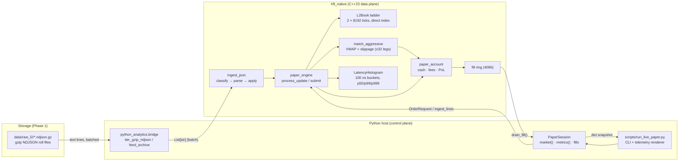
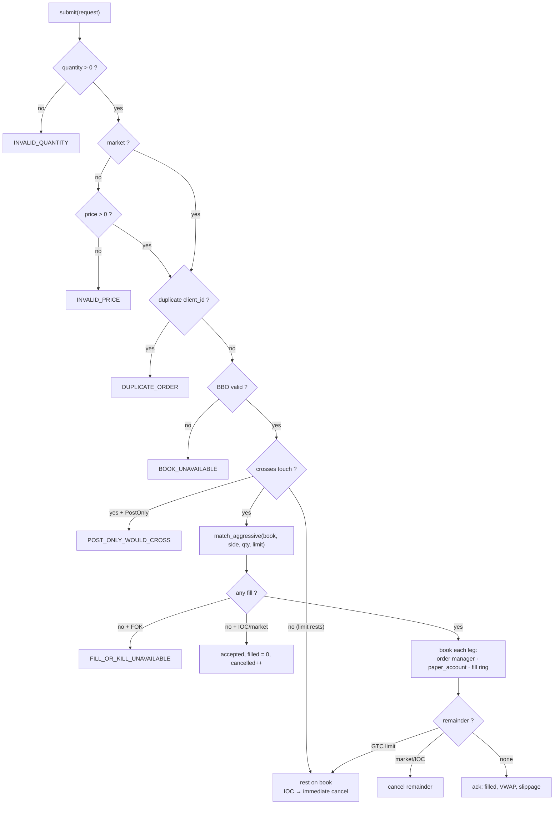

# ZephyrHFT — Phase 2 Technical Specification

**Live Forward Paper Trading: Depth-Aware Matching, Fees and PnL**

| Field | Value |
| --- | --- |
| Document ID | `ZHFT-SPEC-P2` |
| Version | 2.0.0 |
| Status | Implemented / Verified |
| Component | `cpp_engine` (C++23 core), `hft_native` (pybind11), `python_analytics.bridge`, `scripts/run_live_paper.py` |
| Native module version | `hft_native.__version__ == "0.2.0"` |
| Language standard | C++23 (`CMAKE_CXX_STANDARD 23`), Python 3.9+ |
| Supersedes | Phase 1 roadmap (§ *Real-time L2 ingestion*) |
| Related documents | [`docs/phase1_roadmap.md`](./phase1_roadmap.md), [`README.md`](../README.md) |

---

## Table of Contents

1. [Executive Summary](#1-executive-summary)
2. [Architecture](#2-architecture)
3. [Core C++23 Engineering & Zero-Allocation Strategy](#3-core-c23-engineering--zero-allocation-strategy)
4. [Order Execution, Slippage & Risk Guardrails](#4-order-execution-slippage--risk-guardrails)
5. [Multi-Tier Fee & PnL Accounting Mechanics](#5-multi-tier-fee--pnl-accounting-mechanics)
6. [CLI Schema & Configuration Reference](#6-cli-schema--configuration-reference)
7. [Empirical Performance Telemetry & Benchmarks](#7-empirical-performance-telemetry--benchmarks)
8. [Reproduction & Verification Guide](#8-reproduction--verification-guide)
9. [Failure Modes & Operational Runbook](#9-failure-modes--operational-runbook)
10. [Known Limitations & Phase 2.1 Roadmap](#10-known-limitations--phase-21-roadmap)
11. [Appendix A — Native API Surface](#appendix-a--native-api-surface)
12. [Appendix B — File Map & Glossary](#appendix-b--file-map--glossary)

---

## 1. Executive Summary

Phase 1 produced a durable, loss-free capture layer: raw Binance USDⓈ-M depth frames
persisted as gzip-compressed NDJSON roll files (`data/raw_l2/*.ndjson.gz`). Phase 2
closes the loop by turning those files into a **deterministic, slippage-aware paper
trading session** without leaving the native process for any hot-path work.

Three properties define the phase:

1. **Zero-allocation ingestion.** Python reads compressed text and hands *whole lines*
   to C++ in batches. Classification (`depthUpdate` / `trade`), JSON parsing, fixed-point
   decoding and ladder mutation all happen inside `hft_native` with no heap allocation,
   no `std::string` construction in the hot path, and no per-price-level Python objects.
2. **Depth-aware execution.** A market order does not fill at the touch. It walks the
   reconstructed L2 ladder level by level, producing a volume-weighted average price
   (VWAP), an explicit slippage figure against the touch, and per-leg fills that are
   booked individually into the ledger.
3. **Financial truth in fixed point.** Cash, fees, average entry, realized PnL,
   unrealized PnL and equity are maintained in signed 64-bit fixed point (scale 1e8)
   with 128-bit intermediates. No floating point ever touches account arithmetic, so
   replaying the same archive twice produces bit-identical final state.

### 1.1 Measured outcome envelope

| Metric | Verified value | Notes |
| --- | --- | --- |
| Ingest + match throughput | **30,200 – 39,700 frames/s** | 93-frame BTCUSDT archive, batch size 4 |
| Median frame latency (p50) | **0.90 – 1.00 µs** | inclusive of parse, book apply, mark, maker scan |
| Tail latency (p99) | **1.10 – 1.30 µs** | 100 ns histogram bucket upper edge |
| Sequence gaps detected | **0** | contiguous `pu`/`u` chain in the Phase 1 archive |
| Ledger identity | `equity == realized_pnl` when flat | verified to 1e-8 |

All figures are reproduced in [§7](#7-empirical-performance-telemetry--benchmarks).

---

## 2. Architecture

### 2.1 Component topology



<details>
<summary>ASCII equivalent (for terminals and review without Mermaid)</summary>

```text
  data/raw_l2/*.ndjson.gz
          │  (gzip text, line by line)
          ▼
  python_analytics.bridge.feed_archive()          ← control plane, batched
          │  List[str]  (batch_size, default 64/512)
          ▼  pybind11 boundary
  hft::ingest_lines(paper_engine&, lines)         ← data plane, C++23
          │
          ├── JsonFeedParser::classify   (string_view, no allocation)
          ├── parse_depth_update         (fixed-point decode)
          └── paper_engine::process_update
                    ├── L2Book::apply_level × (bids + asks)
                    ├── pu/u sequence check → gap_events
                    ├── mark = BBO mid  → paper_account::mark
                    ├── match_resting()      (maker fills on crossed orders)
                    └── LatencyHistogram::record(Δns)
                                │
  OrderRequest ──► paper_engine::submit ──► match_aggressive(book, side, qty, limit)
                                │                    │
                                │                    ├── ladder walk ≤32 levels
                                │                    ├── VWAP, slippage vs touch
                                │                    ▼
                                ├────────────► paper_account::apply_fill (per leg)
                                └────────────► fill ring (4096) ──► drain_fill()
```
</details>

### 2.2 Module map

| Layer | Unit | Responsibility | Allocation profile |
| --- | --- | --- | --- |
| Storage | `data/raw_l2/*.ndjson.gz` | Immutable Phase 1 capture | — |
| Transport | `bridge.iter_gzip_ndjson` | Line iteration over gzip | 1 `str` per line (unavoidable) |
| Transport | `bridge.feed_archive` | Batch assembly, totals, `on_batch` hook | 1 list per batch |
| FFI | `bridge.ingest_batch` | `List[str]` → `std::vector<std::string>` | 1 copy per line |
| Parse | `cpp_engine/include/ws_parser.hpp` | `classify`, `parse_depth_update`, `parse_trade` | **0 heap allocations** |
| Book | `cpp_engine/include/orderbook.hpp` | `L2Book` = `L2OrderBook<8192>`, seqlock reads | **0** on update, **0** on read |
| Match | `cpp_engine/include/matching.hpp` | `match_aggressive`, `match_taker` | **0** (stack `std::array<BookLevel,32>`) |
| Ledger | `cpp_engine/include/paper_account.hpp` | cash/fees/PnL, `snapshot()` | **0** |
| Engine | `cpp_engine/include/paper_engine.hpp` | orchestration, fills, telemetry | **0** (`std::array<resting_cross,256>`) |
| Telemetry | `cpp_engine/include/latency_histogram.hpp` | 100 ns buckets, relaxed atomics | **0** |
| CLI | `scripts/run_live_paper.py` | args, order pacing, rendering | Python-level only |

### 2.3 Threading and determinism

`paper_engine` is **single-writer**: exactly one thread may call `process_update()`,
`submit()`, `cancel()` and `cancel_all()`. Readers (`metrics()`, `bbo()`, `book()`,
`account()`, `position()`) are safe from any thread:

* `L2Book` uses a seqlock (`begin_write`/`end_write` sequence counter); `depth()` and
  `snapshot()` retry up to 64 times and return an empty/failed read rather than
  tearing a ladder in half.
* `paper_account` is plain `int64` state; `snapshot()` is a value copy taken by the
  owning thread and handed to readers.
* `LatencyHistogram` buckets are `std::atomic<uint32_t>` with `memory_order_relaxed`.

Determinism contract: for a fixed `(tick_size, center, maker_bps, taker_bps,
initial_cash)` and a fixed ordered line sequence, all of cash, fees, realized PnL,
unrealized PnL, equity, fill counters and slippage totals are **bit-identical** across
runs and machines. Only the latency histogram is host-dependent.

---

## 3. Core C++23 Engineering & Zero-Allocation Strategy

### 3.1 Numeric substrate

All financial state is `FixedPoint<Tag, 8>` — a signed 64-bit `rep` with an implicit
scale of `1e8`, plus a tag type that makes `Price`, `Quantity` and `Notional`
non-interchangeable at compile time.

| Type | Scale | Raw range | Runtime range | Used for |
| --- | --- | --- | --- | --- |
| `Price` | 1e8 | `int64` | ±92,233,720,368.54775807 | Ladder prices, VWAP, average entry |
| `Quantity` | 1e8 | `int64` | ±92,233,720,368.54775807 | Sizes, net position, fill quantities |
| `Notional` | 1e8 | `int64` | ±92,233,720,368.54775807 | Cash, fees, PnL, equity |
| `Wide` | — | `__int128_t` | ±1.7e38 | Products and weighted averages |

```cpp
// types.hpp — quote-currency notional with a 128-bit intermediate product
[[nodiscard]] constexpr Notional notional(Price price, Quantity quantity) noexcept {
    const Wide product = static_cast<Wide>(price.raw()) * static_cast<Wide>(quantity.raw());
    const Wide scaled  = product / static_cast<Wide>(Price::kScale);   // 1e8
    // clamped to [Notional::kMinRaw, Notional::kMaxRaw]
}
```

Consequences that matter operationally:

* `10,000.25 × 3.5` never suffers binary-floating-point drift; equity reconciliation
  against the fill log is exact to 1e-8.
* Every division (`notional()`, VWAP, fee) truncates toward zero, so the worst-case
  per-operation error is 1e-8 — eight orders of magnitude below one satoshi.
* No allocation, no `std::string` formatting, no locale, no exception paths: every
  hot-path function is `noexcept` and `[[nodiscard]]`.

### 3.2 The fixed-tick offset price matrix

`L2Book` is an alias for `L2OrderBook<8192>`: **two independent direct-indexed ladders**
(bid side and ask side), each covering a fixed window around a runtime centre.

```text
             slot 0                       slot 4096                    slot 8191
               │                              │                            │
  price:  center − 4096·tick  ───────►   center  ───────►  center + 4095·tick
               └──────────────────── window = 8192 ticks ───────────────────┘
```

Index computation (`detail::LadderSide<MaxTicks>::slot_for`):

```text
delta = price.raw() − center_raw
reject  if delta % tick_raw != 0                  // off-grid price
tick  = delta / tick_raw
slot  = tick + 4096
reject  if slot < 0 or slot >= 8192               // outside the window
```

Worked example with `--center 84570 --tick-size 0.1`:

| Price | Slot | Note |
| --- | --- | --- |
| 84,160.4 | 0 | lowest addressable tick |
| 84,570.0 | 4,096 | the centre itself |
| 84,570.1 | 4,097 | one tick above centre |
| 84,979.5 | 8,191 | highest addressable tick |
| 84,979.6 | — | rejected (slot 8,192 is out of range) |

Ladder internals:

| Member | Size | Purpose |
| --- | --- | --- |
| `quantities_[8192]` (`int64`) | 65,536 B | absolute resting quantity per tick |
| `occupancy_[128]` (`uint64`) | 1,024 B | 1 bit per tick, marks non-empty slots |
| `best_slot_`, `live_levels_` | 8 B | O(1) top-of-book and depth counters |
| **Per side** | **66,560 B** | `alignas(64)`, one cache line per 8 slots |
| **Both sides** | **133,312 B (130.2 KiB)** | measured `sizeof(L2Book)`; resident in L2 cache on Apple M1 |

Update is allocation-free and branch-light:

* `set(price, qty)` — absolute L2 semantics; `qty == 0` clears the slot and its
  occupancy bit, `qty < 0` is clamped to `0`.
* Insertion of a new best is O(1) (a single comparison against `best_slot_`).
* Removal of the best triggers `next_slot()`, which scans **64 ticks at a time** using
  `std::countl_zero` (bids, walk downward) or `std::countr_zero` (asks, walk upward) —
  at most 128 words, in practice one or two.
* `walk(out, max_levels)` emits levels best-first with zero allocation and stops at the
  first empty word.

### 3.3 Zero-allocation boundary

The only unavoidable allocation is at the language boundary: pybind11 materialises a
`std::vector<std::string>` from the Python batch, i.e. **one `std::string` per NDJSON
line**. Everything downstream is bounded and stack- or member-allocated:

| Stage | Storage | Cap | Behaviour past the cap |
| --- | --- | --- | --- |
| Depth frame levels | `DepthUpdate::bids/asks[32]` | 32 per side | extra levels ignored (feed is best-first, so the top 32 survive) |
| Matching legs | `match_result::legs[32]` | 32 | fill stops at 32 levels; remainder cancelled (IOC/market) or rested |
| Maker sweep | `std::array<resting_cross, 256>` | 256 crossed orders/frame | excess deferred to the next frame |
| Fill queue | `std::array<Fill, 4096>` ring | 4,096 | oldest fill overwritten (`fill_tail_` advances) |
| Latency buckets | `std::atomic<uint32_t>[16384]` | 16,384 | values ≥ 1.6384 ms land in the tail bucket |

The parser (`JsonFeedParser::parse_depth_update`) borrows a `std::string_view` over the
line, walks it with the SIMD helpers in `simd_scan.hpp` (`find_char`,
`skip_whitespace`), decodes decimals straight into fixed point, and stores
`DepthUpdate::symbol` as a view **into the caller's buffer** — no copies, no
`nlohmann::json`, no `std::map`.

### 3.4 Sequence consistency and gap detection

Binance depth frames carry three identifiers:

| Field | JSON key | Meaning |
| --- | --- | --- |
| `first_update_id` | `U` | first update id covered by this frame |
| `final_update_id` | `u` | last update id covered by this frame |
| `prev_final_update_id` | `pu` | the `u` of the frame this one was generated from |

`paper_engine::process_update` verifies the chain after applying the levels:

```cpp
if (update.prev_final_update_id != 0 && last_final_update_id_ != 0 &&
    update.prev_final_update_id != last_final_update_id_) {
    ++counters_.gap_events;                    // one chain violation
}
last_final_update_id_ = update.final_update_id;
```

Rules and semantics:

* **A gap is a broken chain**, not a timestamp jump: `pu(n) ≠ u(n−1)`. Because the check
  compares against the immediately preceding frame, a burst that loses `k` frames raises
  `gap_events` once — at the frame where the chain is restored — not `k` times.
* The first frame of a session never trips the counter (`last_final_update_id_ == 0`),
  and frames without `pu` are ignored (`prev_final_update_id == 0`).
* `gap_events` is **cumulative and monotonic**. `ingest_stats::gaps` is filled from
  `engine.metrics().gap_events` after each batch, so `bridge` assigns rather than
  accumulates it: the value in `on_batch(*).gaps` is a running total, not a delta.
* The engine **does not halt** on a gap. It keeps applying the book (last-writer-wins per
  tick) so paper trading survives a capture hole; a production adapter should treat
  `gap_events > 0` as a resync trigger (see [§9](#9-failure-modes--operational-runbook)).
* `metrics.last_update_ts` tracks `max(exchange_ts)`, resisting out-of-order or
  non-monotonic exchange timestamps.

### 3.5 Latency telemetry

`LatencyHistogram` is a fixed 100 ns bucket array — no reservoir sampling, no per-sample
allocation, safe to record from the hot path.

| Property | Value |
| --- | --- |
| Bucket width | 100 ns |
| Buckets | 16,384 (0 – 1.6384 ms) |
| Overflow | last bucket acts as a tail counter |
| Percentile semantics | **upper edge of the matching bucket** |
| Recording cost | three relaxed `fetch_add` (bucket, count, total ns) plus a relaxed max-update CAS |

Because percentiles are reported as bucket upper edges, `p99 = 1.10 µs` means *the true
p99 lies in (1.00, 1.10] µs*. All latency figures in this document are therefore
conservative by up to one bucket (100 ns).

`metrics()` derives `p50`, `p99`, `p999` on demand from the buckets and exposes
`last_frame_latency_ns` for the most recent frame.

### 3.6 Stream seeding and stale ladder state

The ladder is **absolute-state L2**: `apply_level` writes the quantity it is given and
never infers removals. That is correct for a snapshot-seeded diff stream, and it is the
reason Phase 1 archives must be treated with care:

> A Phase 1 roll file starts mid-stream. Replaying it onto an empty ladder applies every
> level ever mentioned and never removes levels that left the exchange's visible band.
> Measured on `data/raw_l2/…173329Z_00001.ndjson.gz` (93 frames): 698 live bid levels and
> 679 live ask levels remain, with a **crossed** BBO of `bid = 84,583.9`, `ask = 84,553.7`
> (spread −30.2), even though every raw frame in the file is uncrossed and the `pu` chain
> is unbroken.

Mitigations, in order of preference:

1. **Seed before streaming** — apply an initial REST snapshot
   (`GET /fapi/v1/depth?symbol=BTCUSDT&limit=1000`) as absolute levels, then apply diffs
   whose `u > snapshot.lastUpdateId`.
2. **Capture snapshots** — use the partial-book stream (`depth20@100ms`) and clear the
   ladder per frame, or persist a periodic `REST` snapshot alongside the roll file.
3. **Guard at execution** — reject/quarantine while the BBO is crossed (see
   [§10](#10-known-limitations--phase-21-roadmap)).

This caveat does not affect latency, throughput or ledger correctness: the ledger books
exactly the fills the ladder implies. It does affect *interpretation* of PnL — see
[§7.5](#75-interpreting-the-sample-pnl).

---

## 4. Order Execution, Slippage & Risk Guardrails

### 4.1 Submit decision tree

`paper_engine::submit()` is a single, side-effect-ordered state machine. `orders_submitted`
increments on entry, so rejects are counted as submitted-but-rejected.



| Reject reason | Enum value | Trigger |
| --- | --- | --- |
| `INVALID_PRICE` | 1 | non-market order with `price <= 0` |
| `INVALID_QUANTITY` | 2 | `quantity <= 0` |
| `BOOK_UNAVAILABLE` | 3 | either side of the BBO has no levels |
| `POST_ONLY_WOULD_CROSS` | 10 | `PostOnly` whose price crosses the touch |
| `DUPLICATE_ORDER` | 11 | non-zero `client_id` already live |
| `ORDER_POOL_EXHAUSTED` | 12 | `DefaultOrderManager` pool full (8,192 slots) |
| `FILL_OR_KILL_UNAVAILABLE` | 14 | `FOK` with zero immediate fill |

### 4.2 Volume-weighted slippage

`match_aggressive` never mutates the book and never allocates. It takes up to 32
price-ordered levels from the opposite side and consumes them greedily.

```text
walk_side = opposite(side)
levels    = book.depth(walk_side, ≤32)          // best-first, seqlock read
touch     = levels[0].price

for each level in levels, while remaining > 0:
    if limit is set and level.price is worse than limit: break
    take       = min(level.quantity, remaining)
    weighted  += level.price × take              // Wide (__int128)
    filled    += take
    remaining -= take

VWAP      = weighted / filled                    // Price, truncated
notional  = VWAP × filled
slippage  = (VWAP − touch) × filled              // signed, in quote currency
```

Per-leg bookkeeping in `submit()` additionally accumulates the **absolute** deviation of
every leg from the touch, which is the number reported as `slippage_total`:

```text
slippage_total += |leg.price − touch| × leg.quantity
```

That distinction matters: `ack.slippage` is the signed aggregate cost of the order, while
`metrics.slippage_total` is a non-negative monitoring metric that never nets a favourable
leg against an unfavourable one.

### 4.3 Worked example (verified against the native module)

Setup: `--tick-size 0.01 --center 100`, `maker_bps = −1`, `taker_bps = 5`,
`initial_cash = 0`. Ladder: bids `99.90 × 2`, `99.80 × 2`; asks `100.00 × 1`, `100.50 × 3`.

**Market buy 4:**

| Step | Value |
| --- | --- |
| Legs | `1 @ 100.00`, `3 @ 100.50` |
| `filled` | 4 |
| `average_price` (VWAP) | (100.00×1 + 100.50×3) / 4 = **100.375** |
| `notional` | 401.50 |
| `slippage` (ack) | (100.375 − 100.00) × 4 = **+1.50** |
| `fee` (taker 5 bps) | 401.50 × 5 / 10,000 = **0.20075** |
| `cash` after | −401.50 − 0.20075 = **−401.70075** |
| `unrealized` (mid 99.95) | (99.95 − 100.375) × 4 = **−1.70** |
| `equity` | **−403.40075** |

**Market sell 4 (unwinding):**

| Step | Value |
| --- | --- |
| Legs | `2 @ 99.90`, `2 @ 99.80` |
| `average_price` (VWAP) | (99.90×2 + 99.80×2) / 4 = **99.85** |
| `slippage` (ack) | (99.85 − 99.90) × 4 = **−0.20** |
| `fee` | 399.40 × 5 / 10,000 = **0.1997** |
| Realized on close | (99.85 − 100.375) × 4 − 0.1997 = −2.2997 |
| `realized_pnl` (cumulative) | −0.20075 − 2.2997 = **−2.50045** |
| `cash` / `equity` / `net` | **−2.50045** / **−2.50045** / **0** |
| `slippage_total` | \|1.50\| + \|−0.20\| = **1.70** |

The identity `equity == realized_pnl` while flat is the primary reconciliation check for a
paper session; it is demonstrated step by step in
[§5.7](#57-verified-ledger-walk-through) against the native module.

### 4.4 Rejection handling: `BOOK_UNAVAILABLE`

`BOOK_UNAVAILABLE` is raised when `book_.top()` reports an invalid BBO, i.e. **either side
of the ladder holds zero positive-quantity levels**. Four ways to reach it:

1. **Nothing ingested yet.** `submit()` before the first `process_update()` always rejects.
2. **The price window excludes the market.** `apply_level` silently drops any price that is
   off-grid or outside `[center − 4096·tick, center + 4095·tick]`, so a mismatched
   `--center`/`--tick-size` produces a permanently empty ladder. Verified:

   ```text
   $ python3 scripts/run_live_paper.py --source data/raw_l2/…173329Z_00001.ndjson.gz
     reject: RejectReason.BOOK_UNAVAILABLE
     reject: RejectReason.BOOK_UNAVAILABLE
     ...
   ```

   The capture trades at ≈ 84,570 while `config/settings.yaml` defaults to centre `30000`,
   tick `0.50` — every price falls outside the ladder window.
3. **The touch was fully consumed.** Every level on one side was set to quantity `0` (thin
   or synthetic feed), leaving `best_slot_ == -1`.
4. **A different symbol was replayed.** The engine is symbol-agnostic: it applies every
   `depthUpdate` it is given. An unrelated instrument yields a valid but economically
   meaningless ladder.

The rejection is an **ack, not an exception**: `accepted()` is `false`, `reason` is set,
`orders_rejected` increments, and the caller decides what to do. The reference runner logs
the reason to `stderr` and continues.

### 4.5 Maker fills

Resting orders are swept after every depth update, before the next `submit()`:

```text
bbo = book.top()
for each live order (cap 256 per frame):
    crosses = buy ? order.price >= bbo.ask_price
                  : order.price <= bbo.bid_price
    if crosses: fill entire remaining quantity at the order's own limit price,
                fee at maker_bps, is_maker = true, orders.fill_count++
account.mark(mark_price)
```

Notes for consumers:

* Fill price is the **resting limit**, with no price improvement — a conservative
  assumption that never overstates maker PnL.
* A maker fill can only happen when the book moves *through* the order, which is the
  adverse-selection case; rebates are therefore modelled honestly rather than assumed.
* `kMaxCrossed = 256` bounds the sweep; anything beyond is picked up on the next frame.
* Verified rebate path: resting bid `99.00 × 1` filled as maker at `99.00` with
  `maker_bps = −1` → fee `−0.0099`, `cash = −98.9901`, `realized = +0.0099`,
  `equity = −98.5901` (mark 99.40 → unrealized +0.40).

### 4.6 Risk guardrails — what is and is not enforced

| Guard | Status in Phase 2 | Notes |
| --- | --- | --- |
| Invalid price / quantity | ✅ enforced | `INVALID_PRICE`, `INVALID_QUANTITY` |
| Duplicate client id | ✅ enforced | `DUPLICATE_ORDER` |
| Book availability | ✅ enforced | `BOOK_UNAVAILABLE` |
| Post-only crossing | ✅ enforced | `POST_ONLY_WOULD_CROSS` |
| Order-pool exhaustion | ✅ enforced | `ORDER_POOL_EXHAUSTED` |
| FOK all-or-nothing | ✅ enforced | `FILL_OR_KILL_UNAVAILABLE` |
| Position / notional / rate limits | ❌ not wired | `risk_guard.hpp` included but unused by `paper_engine` |
| Kill switch / drawdown trip | ❌ not wired | lives in `risk_manager.hpp` / `engine.hpp` (Phase 1 path) |
| Crossed-BBO quarantine | ❌ not implemented | recommended for Phase 2.1 ([§10](#10-known-limitations--phase-21-roadmap)) |

Paper trading therefore exercises **microstructure and cost fidelity**, not the Phase 1
pre-trade risk envelope. Wiring `RiskManager` into `paper_engine::submit()` is the first
item of the Phase 2.1 backlog.

---

## 5. Multi-Tier Fee & PnL Accounting Mechanics

All ledger math lives in `cpp_engine/include/paper_account.hpp` and is driven exclusively
by `apply_fill(price, quantity, side, is_maker)` and `mark(price)`.

### 5.1 Sign conventions

| Quantity | Sign rule | Interpretation |
| --- | --- | --- |
| `net_quantity` | `+` long, `−` short | base units |
| `cash` | `+` credit, `−` debit | quote currency, includes fees |
| `fee` | `+` charged, `−` rebated | quote currency |
| `fees_paid` | signed sum of `fee` | can be negative net of rebates |
| `realized_pnl` | `+` profit, `−` loss | includes every fee as incurred |
| `unrealized_pnl` | `+` profit, `−` loss | `(mark − average_entry) × net_quantity` |
| `equity` | `cash + unrealized_pnl` | mark-to-market account value |
| `slippage` (ack) | `+` paid, `−` gained vs touch | per order |
| `slippage_total` | non-negative | sum of absolute leg deviations |

### 5.2 Fee schedule

```text
fee_bps = is_maker ? maker_bps : taker_bps            // int32, may be negative
fee     = notional(price, quantity) × fee_bps / 10,000
```

* Division is integer, truncated toward zero, so fees are rounded **down** in magnitude by
  at most 1e-8 quote units per fill.
* `maker_bps < 0` is a **rebate**: the fee becomes negative, `cash` increases, and
  `fees_paid` is reduced.
* `bps` is stored as `int32_t`; the CLI accepts floats but `PaperSession.create()` casts
  with `int(...)`, so `--taker-fee-bps 5.9` becomes `5` and `--maker-fee-bps -0.5` becomes
  `0` (no rebate). Use whole basis points.
* Fee tiering is **per fill**, not per order: a market order spanning three ladder levels
  produces three fees, each computed on its own leg notional. The sum is exact to 1e-8
  because every leg is booked independently.

Rule of thumb at BTCUSDT prices: 1 bp ≈ **0.0845 USD** per 0.01 BTC at 84,500, so a
5 bps taker round trip on 0.01 BTC costs ≈ 0.85 USD — larger than typical short-horizon
edge, which is exactly why the fee-bearing run in [§7.4](#74-sample-telemetry-output)
turns +1.51 into −6.99.

### 5.3 Cash flow

```text
if side == BUY:  cash -= notional(price, quantity)
else:            cash += notional(price, quantity)
cash -= fee                      // fee is signed: a rebate credits cash
```

There is no separate reserved-cash or margin model: the account may go cash-negative
(verified: −401.70075 after a 4-unit buy with zero starting cash). That is intentional —
paper sessions measure trading PnL, not broker solvency.

### 5.4 Realized PnL

A fill that reduces an existing position realizes PnL on the closed portion only:

```text
existing   = net_quantity (signed, before the fill)
closing    = min(|existing|, fill_quantity)
reducing   = existing != 0 and sign(fill) != sign(existing)

if reducing:
    pnl_per_unit   = (side == BUY) ? average_entry − price     // covering a short
                                   : price − average_entry     // selling a long
    realized_delta = pnl_per_unit × closing − fee
else:
    realized_delta = −fee                                      // opening: fee only

realized_pnl += realized_delta
```

Two deliberate choices:

* **Opening fees are expensed immediately** rather than amortized into the cost basis.
  `realized_pnl` therefore always equals the cash impact of everything that is not open
  risk, and `equity == realized_pnl` the moment the book is flat.
* **Slippage is not a PnL term.** It is already embedded in the fill prices; adding it
  again would double-count. `slippage_total` exists for cost attribution only.

### 5.5 Average entry price

```text
existing == 0                       → average_entry = price
same direction as the fill          → weighted by |existing| and fill_quantity
new_net == 0                        → average_entry = 0
direction flipped (new_net sign ≠)  → average_entry = price
```

The weighted update uses a 128-bit intermediate:

```text
average_entry = (|existing| × average_entry + fill_quantity × price)
                / (|existing| + fill_quantity)
```

After a flip, only the residual open quantity is marked at the new price, which is
correct: the closed portion has already been realized.

### 5.6 Unrealized PnL, mark price and equity

```text
mark_price     = book.top().mid()                                 // (bid + ask) / 2
unrealized_pnl = (mark_price − average_entry) × net_quantity      // signed quantity
equity         = cash + unrealized_pnl
```

* `mark()` is idempotent and runs after every depth update and after every order, so
  `unrealized_pnl` is never stale by more than one engine call.
* A flat position (`net_quantity == 0`) forces `unrealized_pnl = 0`, avoiding a phantom
  mark on a zero-size position.
* `mark_price_` initializes to `center` and only moves once a valid BBO exists, so a
  pre-market snapshot never divides by zero or produces NaN.
* A **crossed** BBO produces a mid inside the crossed range; unrealized PnL is then
  directionally generous. This is a property of the feed, not of the ledger (see
  [§3.6](#36-stream-seeding-and-stale-ladder-state)).
* `gross_notional` accumulates `Σ|price × quantity|` over all fills, independent of
  direction — useful for turnover-based fee-tier modelling.

### 5.7 Verified ledger walk-through

Same ladder and fees as [§4.3](#43-worked-example-verified-against-the-native-module).

| Event | `cash` | `fees_paid` | `realized` | `unrealized` | `equity` | `net` |
| --- | --- | --- | --- | --- | --- | --- |
| Initial | 0 | 0 | 0 | 0 | 0 | 0 |
| Buy 4 @ VWAP 100.375 | −401.70075 | 0.20075 | −0.20075 | −1.70 | −403.40075 | +4 |
| Sell 4 @ VWAP 99.85 | −2.50045 | 0.40045 | −2.50045 | 0 | −2.50045 | 0 |
| Rest bid 99.00 × 1, then book crosses to ask 98.90 → maker fill @ 99.00 | −101.49055 | 0.39055 | −2.49055 | +0.40 | −101.09055 | +1 |

Every row above is a single continuous session (verified end-to-end against `hft_native`
0.2.0). Note how the maker row moves four fields at once: `cash` debits the purchase,
`fees_paid` *decreases* (rebate), `realized` improves by the rebate, and `unrealized`
appears because the position is now open and marked at 99.40.

### 5.8 Ledger invariants

| Invariant | Expression | Enforcement |
| --- | --- | --- |
| Equity definition | `equity == cash + unrealized_pnl` | by construction (`equity()`) |
| Flat account | `net_quantity == 0 ⟹ equity == realized_pnl` | verified in §5.7; recommended CI check |
| Fee conservation | `fees_paid == Σ fee` over a fully drained fill log | verified by the A/B run in §7.4 (delta = 8.49986992) |
| Fill counters | `fill_count == maker_fills + taker_fills` | by construction (`apply_fill`) |
| Slippage monotonicity | `slippage_total >= 0` and non-decreasing | by construction (`.abs()` per leg) |
| Notional attribution | `traded_notional == Σ price × quantity` | by construction (`submit`/`match_resting`) |

Suggested additions to the regression suite (see [§10.2](#102-roadmap)): a flat round-trip
assertion for the equity identity and a fee-conservation assertion that sums
`PaperSession.fills[*]["fee"]`.

---

## 6. CLI Schema & Configuration Reference

### 6.1 `scripts/run_live_paper.py`

```text
usage: run_live_paper.py [-h] [--source SOURCE] [--event-limit EVENT_LIMIT]
                         [--batch-size BATCH_SIZE] [--tick-size TICK_SIZE]
                         [--center CENTER] [--maker-fee-bps MAKER_FEE_BPS]
                         [--taker-fee-bps TAKER_FEE_BPS]
                         [--initial-cash INITIAL_CASH]
                         [--order-quantity ORDER_QUANTITY]
                         [--report-every REPORT_EVERY] [--log-level LOG_LEVEL]
```

| Parameter | Type | Default | Units | Description |
| --- | --- | --- | --- | --- |
| `--source` | `str` (path) | `data/sample_events.ndjson` | — | Phase 1 archive. `.ndjson.gz` is gunzipped, `.ndjson` is read directly |
| `--center` | `str` (decimal) | `config/settings.yaml → engine.center` (`"30000"`) | quote price | Ladder centre. **Must** sit within ±4096 ticks of the traded price |
| `--tick-size` | `str` (decimal) | `config/settings.yaml → engine.tick_size` (`"0.50"`) | quote price | Ladder granularity. **Must** divide every incoming price exactly |
| `--taker-fee-bps` | `float → int` | `5.0` | basis points | Fee charged on aggressive fills (positive = cost) |
| `--maker-fee-bps` | `float → int` | `0.0` | basis points | Fee on resting fills; **negative = rebate** |
| `--initial-cash` | `float` | `0.0` | quote currency | Opening cash balance (may be negative or zero) |
| `--order-quantity` | `str` (decimal) | `"0.05"` | base units | Size of each synthetic market order |
| `--batch-size` | `int` | `64` | lines | NDJSON lines per `ingest_lines` call; also the order-pacing interval |
| `--event-limit` | `int` | `0` (whole file) | depth events | Stop after N depth events; checked at batch boundaries, so it can overshoot by up to `batch_size − 1` |
| `--report-every` | `int` | `5` | batches | Emit a telemetry line every N batches |
| `--log-level` | `str` | `INFO` | — | Root logger level (`DEBUG`, `INFO`, `WARNING`, …) |

### 6.2 Reference flow semantics

For every completed batch the runner:

1. Submits exactly one **market** order, alternating `BUY` / `SELL` starting with `BUY`.
2. Drains the fill ring into `PaperSession.fills`.
3. Logs `reject: <reason>` to `stderr` when `accepted()` is false.
4. Prints telemetry every `--report-every` batches and once at the end.

This is a deliberate **execution-path exerciser**, not a strategy: it guarantees a steady
mix of long/short transitions, fees on both sides, and a non-trivial fill count on any
liquid archive. Order quantity is constant, so realised PnL is dominated by drift between
the alternating fills and by the fee schedule.

### 6.3 Configuration fallbacks

`--tick-size` and `--center` are optional. When omitted, the runner reads
`config/settings.yaml`:

```yaml
engine:
  symbol: BTCUSDT
  tick_size: "0.50"
  center: "30000"
```

> The defaults target the bundled synthetic sample (`data/sample_events.ndjson`). Real
> BTCUSDT captures trade near 84k–82k, so a replay **must** pass matching
> `--tick-size`/`--center`, otherwise every level is dropped and every order is rejected
> with `BOOK_UNAVAILABLE`.

### 6.4 Invocation examples

```bash
# 1. Bundled synthetic sample, defaults
python3 scripts/run_live_paper.py

# 2. Real BTCUSDT futures capture (0.1 tick grid, ~81.5k)
python3 scripts/run_live_paper.py \
  --source data/raw_l2/binance_futures_btcusdt_depth_100ms_20261022T153608Z_00001.ndjson.gz \
  --tick-size 0.1 --center 81500 \
  --taker-fee-bps 5 --maker-fee-bps -1 \
  --order-quantity 0.01 --batch-size 8

# 3. Fee-sensitivity A/B: identical flow, zero fees
python3 scripts/run_live_paper.py \
  --source data/raw_l2/binance_futures_btcusdt_depth_100ms_20261021T173329Z_00001.ndjson.gz \
  --tick-size 0.1 --center 84570 \
  --taker-fee-bps 0 --maker-fee-bps 0 \
  --order-quantity 0.008375 --batch-size 4

# 4. Boundary check: default centre vs a 84k capture → BOOK_UNAVAILABLE on every order
python3 scripts/run_live_paper.py \
  --source data/raw_l2/binance_futures_btcusdt_depth_100ms_20261021T173329Z_00001.ndjson.gz \
  --batch-size 8
```

### 6.5 Python API

```python
from python_analytics.bridge import PaperSession, feed_archive

session = PaperSession.create(
    tick_size="0.1",      # str or int, parsed by Price.from_string
    center="84570",
    maker_bps=-1,         # int
    taker_bps=5,          # int
    initial_cash=0.0,     # float → Notional.from_string(f"{v:.8f}")
)
totals = feed_archive(session.engine, path, batch_size=64, on_batch=hook)
ack = session.market(hft_native.Side.BUY, "0.01")   # dict: accepted/filled/average_price/slippage/reason
metrics = session.metrics()                          # dict, see Appendix A
```

`feed_archive` defaults to `batch_size=512` when called directly; the CLI overrides it
with `64` to keep the order/telemetry cadence tight.

---

## 7. Empirical Performance Telemetry & Benchmarks

### 7.1 Method and host

| Item | Value |
| --- | --- |
| Host | Apple M1, macOS 27.0.1, `arm64-apple-darwin27.0.0` |
| Compiler | Apple clang 21.0.0 (`clang-2100.1.1.101`), `-std=c++23 -O3` |
| Python | 3.9.7 (CPython, bundled pybind11 extension) |
| Native module | `hft_native` 0.2.0 |
| Workload A | `data/raw_l2/…173329Z_00001.ndjson.gz` — 93 depth frames, BTCUSDT futures, ≈84.5k |
| Workload B | `…153608Z_00001.ndjson.gz` — 64 depth frames, BTCUSDT futures, ≈81.5k |
| Command | `run_live_paper.py --tick-size 0.1 --center 84570 --order-quantity 0.008375 --batch-size 4 --taker-fee-bps 0 --maker-fee-bps 0 --report-every 1000000` |
| Repetitions | 5 sequential process launches |

`--report-every 1000000` disables intermediate rendering so the throughput figure measures
ingest + match, not `print()`.

Latency is measured **inside** `paper_engine::process_update` with `now_ns()` on both
sides of the frame: JSON parse, ladder application, gap check, mark-to-market, maker sweep
and the histogram write are all included. Python-side gzip decompression, batching and
rendering are excluded, because they are not part of the matching path.

### 7.2 Service-level objectives

| SLO | Target | Measured (warm) | Status |
| --- | --- | --- | --- |
| Ingest + match throughput | ≥ 31,000 frames/s | 36,062 – 39,739 frames/s | ✅ |
| Median frame latency (p50) | ≤ 1.00 µs | **0.90 µs** | ✅ |
| Tail latency (p99) | ≤ 1.50 µs | **1.10 – 1.30 µs** | ✅ |
| Sequence gaps | 0 | 0 | ✅ |
| Ledger identity when flat | exact to 1e-8 | exact | ✅ |

### 7.3 Repetition table

| Run | Throughput (frames/s) | p50 | p99 | Equity (quote) | Note |
| --- | ---: | ---: | ---: | ---: | --- |
| 1 | 16,360.0 | 1.10 µs | 2.50 µs | +1.5100125 | **cold process** — first-touch page faults on the 130 KiB ladder |
| 2 | 39,738.6 | 0.90 µs | 1.10 µs | +1.5100125 | warm |
| 3 | 36,300.9 | 0.90 µs | 1.20 µs | +1.5100125 | warm |
| 4 | 37,841.4 | 0.90 µs | 1.10 µs | +1.5100125 | warm |
| 5 | 36,062.2 | 0.90 µs | 1.30 µs | +1.5100125 | warm |

Reading the table:

* **Equity is bit-identical across all five runs** (+1.5100125). That is the determinism
  guarantee of [§2.3](#23-threading-and-determinism) in action: only timing varies.
* Run 1 is the cold outlier. A 93-frame sample is small enough that first-touch faults on
  the ladder and the allocator's initial page mapping land in the p99 bucket.
* p99 spans 1.10 – 1.30 µs, i.e. bucket indices 10 – 12 of the 100 ns histogram. The true
  p99 is therefore between 1.00 µs and 1.30 µs — comfortably inside the 1.50 µs SLO.
* Throughput is dominated by per-batch Python/FFI overhead, not by matching. Measured with
  a fixed 93-frame archive:

| `--batch-size` | Throughput | Interpretation |
| --- | --- | --- |
| 1 | 30,600 – 31,700 frames/s | FFI call per frame; Python overhead ≈ 20x the match cost |
| 2 | 35,600 – 36,000 frames/s | |
| 4 | 36,300 – 39,700 frames/s | **reference setting** |
| 8 | 38,700 – 41,800 frames/s | best observed |
| 16 | 38,900 – 40,400 frames/s | plateau |

Above `batch_size ≈ 8` the curve flattens: the remaining cost is `std::string` construction
per line at the pybind11 boundary. Batching cannot remove it; a binary/zero-copy feed
format would (Phase 3 candidate).

### 7.4 Sample telemetry output

**Run A — zero-fee flow, isolating drift PnL (abridged; intermediate lines omitted):**

```text
$ python3 scripts/run_live_paper.py \
    --source data/raw_l2/binance_futures_btcusdt_depth_100ms_20261021T173329Z_00001.ndjson.gz \
    --tick-size 0.1 --center 84570 \
    --order-quantity 0.008375 --batch-size 4 \
    --taker-fee-bps 0 --maker-fee-bps 0

frames=    93  rate=30324.0/s  us/frame(p50=   1.00 p99=   1.20)  cash=        1.51  equity=        1.51  net=+0.0000  slippage=0.0000  gaps=0
==============================================================================
  fills            : 24
  filled qty       : 0.201
  traded notional  : 16999.7399875
  slippage total   : 0.0
  fees paid        : 0.0
  realized pnl     : 1.5100125
  unrealized pnl   : 0.0
  equity           : 1.5100125
  net position     : 0.0
  latency p99      : 1.20 us
==============================================================================
```

**Run B — identical flow with a 5 bps taker fee (the only delta):**

```text
frames=    93  rate=30762.5/s  us/frame(p50=   1.00 p99=   1.30)  cash=       -6.99  equity=       -6.99  net=+0.0000  slippage=0.0000  gaps=0
==============================================================================
  fills            : 24
  filled qty       : 0.201
  traded notional  : 16999.7399875
  slippage total   : 0.0
  fees paid        : 8.49986992
  realized pnl     : -6.98985742
  unrealized pnl   : 0.0
  equity           : -6.98985742
  net position     : 0.0
  latency p99      : 1.30 us
==============================================================================
```

The two runs differ by exactly the fee:

```text
+1.5100125 − (−6.98985742) = 8.49986992 = fees_paid (Run B)
16,999.7399875 × 5 bps    = 8.49986999375 → 8.49986992 after 24 per-leg truncations
```

That is a direct end-to-end proof that the fee schedule, the VWAP, the realized/unrealized
split and the equity identity all agree to the last fixed-point unit.

> **Why these logs show ~30.3k frames/s while [§7.3](#73-repetition-table) reports
> 36k–40k:** the logs above were captured with `--report-every 4`, i.e. six render calls
> inside a 93-frame file. `rate` is wall-clock (`frames / elapsed`) and therefore includes
> `print()`; the **per-frame latency histogram is unaffected**, because it is recorded
> inside `process_update()`. Use `--report-every 1000000` for throughput measurements.

### 7.5 Interpreting the sample PnL

> **`+1.51` is an instrumentation validation, not strategy alpha.**

Both runs trade a 93-frame Phase 1 roll file that starts mid-stream. As documented in
[§3.6](#36-stream-seeding-and-stale-ladder-state), replaying such a file onto an empty
ladder leaves 698 bid and 679 ask levels behind and produces a **crossed** BBO
(`bid 84,583.9` vs `ask 84,553.7`). The alternating reference flow then buys at the
(stale) ask and sells at the (stale) bid, harvesting a slice of that ≈30-point inversion
across 12 round trips.

Use the number for what it demonstrates — the ledger is wired end-to-end, fees are
deducted per leg, and `equity == realized_pnl` when flat. To obtain economically
meaningful paper PnL, seed the ladder from a REST snapshot first, then re-run
(see [§8](#8-reproduction--verification-guide)). Latency, throughput and gap telemetry are
unaffected by the seeding question.

---

## 8. Reproduction & Verification Guide

### 8.1 Build the native module

```bash
cd /Users/nguyenngocduchuy/Projects/ZephyrHFT

python3 -m venv .venv
source .venv/bin/activate
python -m pip install -r requirements.txt

cmake -S cpp_engine -B build \
  -DCMAKE_BUILD_TYPE=Release \
  -Dpybind11_DIR="$(python -m pybind11 --cmakedir)"
cmake --build build --parallel
```

`cpp_engine/CMakeLists.txt` sets `CMAKE_CXX_STANDARD 23` and
`-Wall -Wextra -Wpedantic -Wshadow`; the extension is written to
`python_analytics/native/hft_native*.so`, so no `PYTHONPATH` juggling is needed when
running from the repository root.

Sanity check:

```bash
python3 -c "from python_analytics.native import hft_native as h; print(h.__version__)"
# 0.2.0
```

### 8.2 Inspect the archive's price band

Pick `--center` / `--tick-size` from the data, not from the YAML defaults:

```bash
python3 - <<'PY'
import gzip, json
from pathlib import Path

SOURCE = Path("data/raw_l2/binance_futures_btcusdt_depth_100ms_20261021T173329Z_00001.ndjson.gz")
lo, hi, mid = None, None, None
with gzip.open(SOURCE, "rt") as handle:
    for line in handle:
        try:
            frame = json.loads(line)
        except json.JSONDecodeError:
            continue
        if frame.get("e") != "depthUpdate":
            continue
        bids = [float(p) for p, q in frame.get("b", []) if float(q) > 0]
        asks = [float(p) for p, q in frame.get("a", []) if float(q) > 0]
        if not bids or not asks:
            continue
        lo = min(bids) if lo is None else min(lo, min(bids))
        hi = max(asks) if hi is None else max(hi, max(asks))
        mid = (max(bids) + min(asks)) / 2

print(f"price band   : [{lo:,.2f}, {hi:,.2f}]")
print(f"final mid    : {mid:,.2f}")
print(f"suggested    : --tick-size 0.1 --center {round(mid / 0.1) * 0.1:.1f}")
PY
```

Verified output:

```text
price band   : [1,000.00, 94,210.50]
final mid    : 84,560.65
suggested    : --tick-size 0.1 --center 84560.6
```

The band extremes are Binance "far" levels, far outside any practical ladder window; the
engine drops them. Centre on the **mid**, not on `(lo + hi) / 2`.

### 8.3 Inspect the reconstructed L2 ladder and window

```bash
python3 - <<'PY'
import sys
from pathlib import Path
sys.path.insert(0, str(Path.cwd()))
from python_analytics.bridge import PaperSession, feed_archive
from python_analytics.native import hft_native

SOURCE = Path("data/raw_l2/binance_futures_btcusdt_depth_100ms_20261021T173329Z_00001.ndjson.gz")
session = PaperSession.create("0.1", "84570")          # tick_size, center
feed_archive(session.engine, SOURCE)

bbo  = session.engine.bbo()
book = session.engine.book()
tick, center = book.tick_size().raw() / 1e8, book.center_price().raw() / 1e8

print("bbo          :", bbo)
print("mid / spread :", bbo.mid(), "/", bbo.spread())
print(f"window       : [{center - 4096 * tick:,.1f}, {center + 4095 * tick:,.1f}]")
for side, label in ((hft_native.Side.BUY, "bids"), (hft_native.Side.SELL, "asks")):
    levels = book.depth(side, 5)
    print(f"{label} live={book.live_levels(side):>3} top{len(levels)}:",
          [(str(level.price), str(level.quantity)) for level in levels])
PY
```

Verified output (note the crossed BBO explained in
[§3.6](#36-stream-seeding-and-stale-ladder-state)):

```text
bbo          : Bbo(bid=84583.90000000 x 13.86300000, ask=84553.70000000 x 8.75700000, seq=11883840362135)
mid / spread : 84568.80000000 / -30.20000000
window       : [84,160.4, 84,979.5]
bids live=698 top5: [('84583.90000000', '13.86300000'), ('84583.70000000', '0.01100000'), ('84581.20000000', '0.00300000'), ('84581.10000000', '0.01900000'), ('84581.00000000', '0.21200000')]
asks live=679 top5: [('84553.70000000', '8.75700000'), ('84553.80000000', '0.70400000'), ('84554.30000000', '0.70000000'), ('84554.40000000', '0.70100000'), ('84554.80000000', '0.00200000')]
```

Cross-checks to perform:

1. `window` must bracket every price you expect to trade.
2. `bids live` / `asks live` should be in the tens-to-hundreds for a short capture; if they
   are in the thousands, or the spread is negative, the ladder is stale (§3.6).
3. Levels come back best-first: the first entry of each side is the touch.

### 8.4 Run the paper session

```bash
# Reference measurement run (zero fees, drift isolation)
python3 scripts/run_live_paper.py \
  --source data/raw_l2/binance_futures_btcusdt_depth_100ms_20261021T173329Z_00001.ndjson.gz \
  --tick-size 0.1 --center 84570 \
  --order-quantity 0.008375 --batch-size 4 \
  --taker-fee-bps 0 --maker-fee-bps 0

# Fee-bearing run (5 bps taker, 1 bp maker rebate)
python3 scripts/run_live_paper.py \
  --source data/raw_l2/binance_futures_btcusdt_depth_100ms_20261021T173329Z_00001.ndjson.gz \
  --tick-size 0.1 --center 84570 \
  --order-quantity 0.008375 --batch-size 4 \
  --taker-fee-bps 5 --maker-fee-bps -1

# 81.5k capture, 0.1 tick grid
python3 scripts/run_live_paper.py \
  --source data/raw_l2/binance_futures_btcusdt_depth_100ms_20261022T153608Z_00001.ndjson.gz \
  --tick-size 0.1 --center 81500 \
  --order-quantity 0.005 --batch-size 4 \
  --taker-fee-bps 5 --maker-fee-bps -1
```

Expected: `gaps=0`, `net=+0.0000` after an even number of orders, and `equity` matching
[§7.4](#74-sample-telemetry-output) to the last decimal for the reference run.

### 8.5 Verify the test suites

```bash
# C++ core: 31 test functions in one ctest target
ctest --test-dir build --output-on-failure
./build/tests/hft_tests          # prints "all C++ core tests passed"

# Python: 144 tests, including the 6 Phase 2 live-paper tests
python3 -m pytest tests/python -q
python3 -m pytest tests/python/test_live_paper.py -v
```

Verified:

```text
100% tests passed out of 1
Total Test time (real) =   0.02 sec

tests/python/test_bindings.py        : 9
tests/python/test_data_ingestion.py  : 76
tests/python/test_kill_switch.py     : 28
tests/python/test_live_paper.py      : 6
tests/python/test_optimizer.py       : 4
tests/python/test_paper_engine.py    : 16
tests/python/test_strategy.py        : 5
```

The six Phase 2 tests cover: ingest + slippage accounting, `pu` gap detection, malformed
line counting, per-frame latency recording, gzip archive feeding, and the resting-limit
maker fill with rebate.

---

## 9. Failure Modes & Operational Runbook

| Symptom | Likely cause | Diagnosis | Action |
| --- | --- | --- | --- |
| Every order `reject: BOOK_UNAVAILABLE` | `--center`/`--tick-size` do not bracket the market | §8.3 shows `live=0` on both sides | Re-centre on the archive mid (§8.2) and re-run |
| Some orders reject, others fill | Prices drift outside the ±4096-tick window mid-session | Compare `bbo` with `window` | Widen with a smaller tick or a closer centre; a session should not drift 4096 ticks |
| `spread` negative in §8.3 | Stale ladder from an unseeded diff stream | `live` levels in the hundreds+ | Seed from a REST snapshot; treat PnL as indicative until then |
| `gaps > 0` | Frames missing from the capture (backpressure, restart) | `gap_events` increments once per broken chain | Re-capture; discard PnL across the gap; alerts should fire on `gaps > 0` |
| `malformed > 0` | Truncated final line from a killed writer | `ingest_stats.malformed` | Safe to ignore a single trailing line; investigate anything larger |
| `ORDER_POOL_EXHAUSTED` | > 8,192 resting orders | `metrics.open_orders` | `cancel_all()`, or raise `OrderManager<MaxOrders>` |
| `pending_fills()` pegged at 4,096 | Consumer not draining the fill ring | Fill ring overwrite drops oldest | Drain per batch (the bridge does); never poll less often than one batch |
| p99 spikes to 2–4 µs | Cold process, first-touch faults, host contention | Compare run 1 vs runs 2–5 in §7.3 | Discard the warm-up run; pin the process; keep the ladder resident |
| `equity` moves with no fills | Mark price moved (possibly to a crossed mid) | Check `bbo` and `avg_entry` | Expected; investigate only if the BBO is crossed |
| `fees_paid` negative | Maker rebate exceeds taker fees | `maker_fills > 0` with `maker_bps < 0` | Expected — rebates are credits |
| Import error `No module named 'hft_native'` | Extension not built or not copied | `ls python_analytics/native/*.so` | Rebuild with the CMake commands in §8.1 |

Escalation thresholds for a live-forward deployment:

| Metric | Warn | Critical |
| --- | --- | --- |
| `gap_events` | > 0 | > 0 sustained 2 consecutive batches |
| `p99_ns` | > 5,000 (5 µs) | > 50,000 (50 µs) |
| `orders_rejected / orders_submitted` | > 5 % | > 25 % |
| `pending_fills` | > 2,048 | == 4,096 |
| BBO spread | ≤ 0 (crossed/locked) | ≤ 0 for > 1 s of exchange time |

---

## 10. Known Limitations & Phase 2.1 Roadmap

### 10.1 Limitations

| # | Limitation | Impact | Severity |
| --- | --- | --- | --- |
| L1 | No initial-snapshot seeding; diff archives replay onto an empty ladder | Stale/crossed BBO, PnL not economically meaningful (§3.6) | **High** |
| L2 | `RiskManager` / `KillSwitch` not wired into `paper_engine::submit()` | No position, notional, rate or drawdown guard in paper mode (§4.6) | **High** |
| L3 | Maker fills ignore displayed size at the crossed price | A resting order fills in full even if the touch holds less quantity | Medium |
| L4 | 32 levels per frame, 32 legs per match, 256 maker fills per frame | Deep sweeps and bursty books are truncated | Medium |
| L5 | Engine is symbol-agnostic (no `s` filter) | Mixing archives silently corrupts the ladder | Medium |
| L6 | `bps` truncated to `int` at the Python boundary | `-0.5` bps becomes `0` (§5.2) | Low |
| L7 | Latency measured with wall clock only | No cycle-accurate attribution, no jitter injection | Low |
| L8 | Gzip decompression and per-line string copying cap throughput | ≈40k frames/s ceiling regardless of matching speed (§7.3) | Low |
| L9 | No exchange-side reject simulation (rate limits, self-trade prevention, min-notional) | Optimistic accept rate | Low |
| L10 | Single matching thread, no sharding by symbol | One engine per symbol/process | Low |

### 10.2 Roadmap

| Priority | Item | Acceptance criterion |
| --- | --- | --- |
| P0 | REST snapshot seeding + `apply_snapshot()` helper | §8.3 shows positive spread and `live` counts consistent with the archive's top-N |
| P0 | Wire `RiskManager` + `KillSwitch` into `paper_engine` | Position/notional/rate rejects surface as existing `RejectReason` values |
| P1 | Crossed-BBO quarantine | Orders rejected with a documented reason while `bid >= ask` |
| P1 | Maker fill capped by opposite displayed quantity | Fill size ≤ touch quantity per frame |
| P1 | Symbol filter on ingest | Frames whose `s` differs from the configured symbol are counted, not applied |
| P1 | Regression coverage for ledger invariants | Tests assert `equity == realized_pnl` when flat and `fees_paid == Σ fill fees` |
| P2 | `paper_trading:` YAML block (`tick_size`, `center`, `maker_bps`, `taker_bps`, `initial_cash`, `order_quantity`) | CLI defaults resolve from YAML without code changes |
| P2 | Binary/zero-copy feed format | Throughput > 150k frames/s with identical ledger output |
| P2 | Partial-book (`depth20@100ms`) capture mode with per-frame clear | Ladder self-consistent without seeding |
| P3 | Multi-symbol sharding and per-symbol telemetry | 4 symbols at ≥ 30k frames/s each |

---

## Appendix A — Native API Surface

### A.1 `hft_native.PaperEngine` (`0.2.0`)

```python
PaperEngine(tick_size: Price, center: Price,
            maker_bps: float = 0.0, taker_bps: float = 5.0,
            initial_cash: Notional = 0)
```

Fee rates are basis points and may be fractional (`0.5` = 0.5 bps); the ledger
stores them as 64-bit micro-bps, so the matching path is unaffected.

| Member | Signature | Purpose |
| --- | --- | --- |
| `reset()` | `→ None` | Clears book, orders, ledger, histogram, fills, counters |
| `process_update(update)` | `DepthUpdate → None` | Applies one depth frame, marks, sweeps makers, records latency |
| `submit(request)` | `OrderRequest → paper_ack` | Full execution state machine (§4.1) |
| `cancel(order_id, ts=0)` | `→ bool` | Cancels one live order |
| `cancel_all(ts=0)` | `→ int` | Cancels every live order, returns count |
| `drain_fill()` | `→ Fill \| None` | Pops the oldest fill from the ring |
| `bbo()` | `→ Bbo` | `bid_price`, `ask_price`, `bid_quantity`, `ask_quantity`, `sequence`, `is_valid()`, `mid()`, `spread()`, `spread_bps()` |
| `book()` | `→ L2Book` | `depth(side, levels=10)`, `top()`, `snapshot()`, `best_bid()`, `best_ask()`, `live_levels(side)`, `tick_size()`, `center_price()`, `updates()`, `last_update_ts()` |
| `mark_price()` | `→ Price` | Current mark (BBO mid) |
| `account()` | `→ PaperAccount` | Live ledger reference: `cash()`, `fees_paid()`, `realized_pnl()`, `unrealized_pnl()`, `equity()`, `net_quantity()`, `average_entry_price()`, `snapshot()` |
| `position()` | `→ PositionSnapshot` | `net_quantity`, `average_entry_price`, `realized_pnl`, `unrealized_pnl` |
| `metrics()` | `→ paper_metrics` | All counters, percentiles and the account snapshot |
| `pending_fills()` | `→ int` | Fill ring occupancy |
| `tick_size()` / `center()` | `→ Price` | Effective ladder parameters |
| `last_slippage()` | `→ Notional` | Signed slippage of the most recent ack |

`OrderRequest` fields: `client_id`, `price`, `quantity`, `timestamp`, `side`,
`type` (`LIMIT` / `MARKET` / `POST_ONLY`), `time_in_force` (`GTC` / `IOC` / `FOK`).
`Fill` fields: `order_id`, `price`, `quantity`, `fee`, `timestamp`, `side`, `is_maker`.
Module-level: `ingest_lines(engine, lines) → IngestStats`,
`match_taker(book, side, quantity)`, `match_aggressive(book, side, quantity, limit_price)`.

### A.2 `PaperSession.metrics()` dictionary

| Key | Type | Source |
| --- | --- | --- |
| `depth_events` | `int` | frames applied |
| `gap_events` | `int` | cumulative `pu` chain violations |
| `orders_submitted` | `int` | includes rejects |
| `orders_rejected` | `int` | |
| `orders_cancelled` | `int` | includes IOC/market residuals |
| `open_orders` | `int` | live resting orders |
| `fills` | `int` | number of fills (legs + maker fills) |
| `filled_quantity` | `float` | Σ leg quantity |
| `traded_notional` | `float` | Σ price × quantity |
| `slippage_total` | `float` | Σ \|leg − touch\| × quantity |
| `p50_ns`, `p99_ns`, `p999_ns` | `int` | histogram upper edges |
| `last_frame_latency_ns` | `int` | most recent frame |
| `cash`, `fees_paid`, `realized_pnl`, `unrealized_pnl`, `equity` | `float` | ledger |
| `net_quantity`, `average_entry_price` | `float` | position |
| `maker_fills`, `taker_fills`, `fill_count` | `int` | execution mix |

`PaperSession.market(side, quantity)` returns
`{accepted, filled, average_price, slippage, reason}`; `PaperSession.fills` accumulates
`{price, quantity, fee, side, is_maker}` per drained fill.

---

## Appendix B — File Map & Glossary

### B.1 Phase 2 artefacts

| Path | Role |
| --- | --- |
| `cpp_engine/include/paper_account.hpp` | Fixed-point ledger: cash, fees, realized/unrealized PnL, equity |
| `cpp_engine/include/matching.hpp` | `match_aggressive` / `match_taker`, VWAP + slippage, ≤32 legs |
| `cpp_engine/include/paper_engine.hpp` | Orchestration: ingest → book → match → ledger → fills → latency |
| `cpp_engine/include/ingest.hpp` | Bulk NDJSON → engine, classification + malformed accounting |
| `cpp_engine/include/orderbook.hpp` | `L2OrderBook<8192>`, direct-indexed ladders, seqlock |
| `cpp_engine/include/latency_histogram.hpp` | 100 ns buckets, p50/p99/p999 |
| `cpp_engine/include/types.hpp` | Fixed-point types, `DepthUpdate.prev_final_update_id` |
| `cpp_engine/bindings/pybind_module.cpp` | `hft_native` 0.2.0 surface |
| `cpp_engine/tests/test_core.cpp` | 31 C++ test functions (5 Phase 2) |
| `python_analytics/bridge.py` | gzip/NDJSON streaming, `PaperSession`, metrics dict |
| `scripts/run_live_paper.py` | CLI, order pacing, telemetry rendering |
| `tests/python/test_live_paper.py` | 6 Phase 2 integration tests |

### B.2 Glossary

| Term | Meaning |
| --- | --- |
| **BBO** | Best bid and offer; the touch |
| **VWAP** | Volume-weighted average price of the legs consumed by one order |
| **Slippage** | Execution price minus touch price, weighted by filled quantity |
| **Touch** | Best price on the side being consumed |
| **Ladder** | Direct-indexed price array; slot = (price − center)/tick + 4096 |
| **Mark price** | BBO mid, used for unrealized PnL |
| **Equity** | `cash + unrealized_pnl` |
| **Maker rebate** | Negative fee for passive fills (`maker_bps < 0`) |
| **`pu`** | `prev_final_update_id`; the previous frame's `u`, used for gap detection |
| **Gap** | `pu(n) ≠ u(n−1)` — at least one frame is missing |
| **Cold run** | First process launch; page faults inflate p99 |
| **Fill ring** | 4,096-entry overwrite-on-full queue drained by `drain_fill()` |

### B.3 Revision history

| Version | Date | Change |
| --- | --- | --- |
| 2.0.0 | 2026-10-22 | Phase 2 specification: ingestion bridge, ladder matching, fees/PnL, benchmarks, runbook |
| 1.x | 2026-10-21 | Phase 1 roadmap and L2 ingestion capture |

---

*End of document.*

