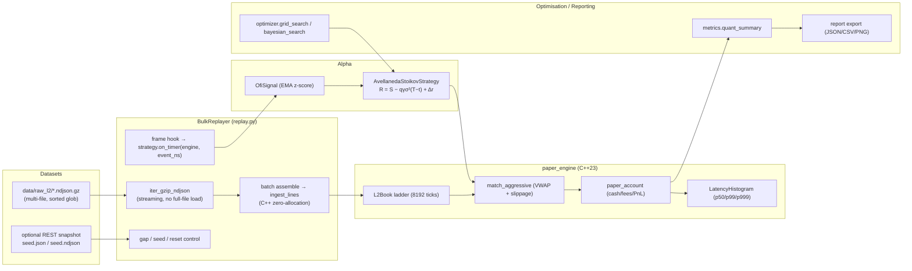

# ZephyrHFT — Phase 3 Technical Plan

**High-Performance Backtesting Architecture & Alpha Strategy Optimisation**

| Field | Value |
| --- | --- |
| Document ID | `ZHFT-PLAN-P3` |
| Version | 3.0.0 |
| Status | Planned / In Implementation |
| Depends on | Phase 1 (NDJSON capture), Phase 2 (`paper_engine`, `bridge`, `ingest_lines`) |
| Related | [`phase2_technical_specification.md`](./phase2_technical_specification.md) |

---

## 1. Objective

Phase 3 turns the Phase 2 deterministic matching engine into a **batch historical
replay and optimisation platform**:

1. Stream multi-gigabyte Phase 1 `.ndjson.gz` archives through the zero-allocation C++
   `paper_engine` at 30–40 k frames/s, executing Python alpha strategies per frame.
2. Couple Order-Flow Imbalance (OFI) and micro-price into the Avellaneda–Stoikov
   reservation price as an alpha-skew term.
3. Optimise `γ`, `κ`, `σ`, OFI threshold and inventory-decay limits against a composite
   risk-adjusted objective.
4. Emit production-grade quant telemetry (financial, execution, system).

### 1.1 Non-goals (explicitly deferred)

* Real-time execution, kill-switch integration into `paper_engine`, and symbol
  filtering remain Phase 2.1 items (see the Phase 2 spec §10).
* Tick data storage format changes; Phase 1 NDJSON remains the canonical archive.
* GPU/vectorised Python strategies — alpha runs in Python, matching stays in C++.

---

## 2. Architecture



### 2.1 Design decisions

| Decision | Rationale |
| --- | --- |
| Replay runs **on `paper_engine`, not `TradingEngine`** | Phase 2 owns the allocation-free `ingest_lines` bulk path and the deterministic ledger; `TradingEngine`'s event-queue/`poll()` model is a live-execution concern |
| **Batching with a frame hook** | `ingest_lines(batch)` amortises one FFI call over N lines; a strategy hook every `frames_per_hook` (default 1) gives per-frame alpha at the cost of amortisation, not correctness |
| **Thin `BacktestEngine` adapter** | `paper_engine` lacks `risk_limits()`; the adapter supplies the wide-limits default so `AvellanedaStoikovStrategy` runs unmodified (backward compatible) |
| **Event time, not wall clock** | `now_ns` (exchange `E` timestamp) replaces `time.monotonic()` inside the strategy, making `T−t` deterministic under replay |
| **Seed-then-stream** | An optional snapshot seeds the ladder; diff frames with `u ≤ snapshot_last_id` are skipped; partial-book (snapshot) archives need no seed |

---

## 3. Module design

### 3.1 `backtesting/replay.py` — bulk replay engine

Additions (existing `replay_lines`/`replay_file` untouched):

```python
class BulkReplayer:
    def __init__(self, *, tick_size, center, maker_bps=-1.0, taker_bps=5.0,
                 initial_cash=0.0, batch_size=64, frames_per_hook=1,
                 seed=None, order_quantity="0.05"): ...
    def reset(self) -> None
    def replay(self, sources, strategy=None, event_limit=0) -> ReplaySummary
    def replay_archives(self, pattern, strategy=None, event_limit=0) -> ReplaySummary
```

* `maker_bps`/`taker_bps` are **fractional** basis points (`0.5` ⇒ 0.5 bps). They are
  never rounded in Python; the C++ ledger freezes them into micro-bps so the fill path
  stays integer-only. Negative `maker_bps` is a rebate.

* `iter_gzip_ndjson` already streams gzip line-by-line (no full-file materialisation).
* `frames_per_hook == 1` ⇒ one-line `ingest_lines([line])` batches, strategy runs per
  frame; `frames_per_hook > 1` ⇒ bulk batches for raw throughput.
* Gap accounting is `engine.metrics().gap_events` (cumulative); per-file deltas are
  computed so a broken roll boundary is visible.
* `seed_from_snapshot(engine, levels)` applies absolute levels to `engine.book()` and
  records `snapshot_last_id` so stale diff frames are skipped.
* `ReplaySummary` carries: stats, fills, equity_curve, slippage_samples, latency
  percentiles, per-file counters, wall-clock duration.

### 3.2 `strategies/indicators.py` — alpha signals

* `OfiSignal(decay=0.95, cap=3.0)` — EMA-tracking mean/variance of OFI, returns a
  z-scored, clipped signal `ofi_z ∈ [−cap, cap]`.
* `SpreadDepthStats` — spread bps, bid/ask depth, depth imbalance, mid/micro price.

### 3.3 `strategies/market_maker.py` — execution coupling

Refined Avellaneda–Stoikov quotes with an alpha-skew reservation:

```text
r(s, q, t)   = s − q·γ·σ²·(T − t) + Δr                 (Δr = ofi_sensitivity · ofi_z)
δᵃ + δᵇ      = γ·σ²·(T − t) + (2/γ)·ln(1 + γ/κ)
half_spread  = (δᵃ + δᵇ) / 2
bid, ask     = r − half_spread, r + half_spread
```

* `ofi_sensitivity` (price units per unit z-score) is opt-in (default 0 = unchanged).
* `use_time_spread` (default `True`) adds the time-decaying `γσ²(T−t)` term to the
  spread; `False` reproduces the legacy liquidity-only spread.
* Event time: `on_timer(engine, now_ns)` records the first `now_ns` as the epoch; a
  `now_ns` of `0`/`None` falls back to wall clock for live paper mode.

### 3.4 `strategies/optimizer.py` — parameter optimisation

* `backtest_parameters()` is rewired from the pure-Python `PaperMatchingEngine` to the
  C++ `paper_engine` via `BulkReplayer` — one code path, 10–100× faster, bit-identical
  ledger.
* `grid_search()` keeps its signature (backward compatible) but delegates to the C++
  replay.
* New `random_search()` (latin-hypercube via `random`, Sobol via `scipy` optional) and
  `bayesian_search()` (`scipy.optimize` GP minimisation, optional import).
* Composite objective minimising max drawdown + inventory variance while maximising
  Sharpe and fill ratio:

```text
score = w_sharpe·sharpe − w_drawdown·max_drawdown − w_inv·σ_inventory
        + w_fill·fill_rate   (higher is better; grid sorts descending)
```

### 3.5 `backtesting/metrics.py` — full telemetry

New `quant_summary(...)` returning:

| Group | Fields |
| --- | --- |
| Financial | `realized_pnl`, `unrealized_pnl`, `gross_pnl`, `sharpe_ratio`, `sortino_ratio`, `max_drawdown_pct`, `win_rate`, `profit_factor`, `pnl_fee_ratio` |
| Execution | `avg_holding_time_s`, `inventory_turnovers`, `fill_rate_pct`, `slippage_mean/p50/p95/p99`, `fee_notional_ratio` |
| System | `depth_events`, `throughput_fps`, `latency_p50/p90/p99/p999_ns` |

`round_trips(fills)` reconstructs FIFO open→close pairs for holding time and win rate.

### 3.6 `backtesting/report.py` — export

JSON (full summary), CSV (fill log + per-parameter grid), PNG (equity curve, drawdown
underwater, fill scatter) via matplotlib when available; silently degrades to
JSON/CSV-only otherwise.

### 3.7 Chaos & resilience (Task 3.1 / 3.2)

| Module | Responsibility |
| --- | --- |
| `cpp_engine/include/risk/heartbeat.hpp` + `src/risk/heartbeat.cpp` | `HeartbeatMonitor`: lock-free dead-man's switch. `beat()` = one release store; `poll()` trips an armed `KillSwitch` once per expiry window; telemetry survives `reset()` |
| `python_analytics/chaos/network.py` | `ChaosNetworkInjector`: frame gate implementing `disconnect_storm` (block the feed) and `latency_injection` (bounded `uniform(min,max)` delay). Clock/sleep/RNG are injectable, so the schedule is unit-testable |
| `python_analytics/chaos/watchdog.py` | `HeartbeatWatchdog`: supervision thread; timeout → `TRIGGERED` → `RECOVERING` → optional `reset()` |
| `python_analytics/bridge.py` | `feed_archive(frame_gate=..., should_stop=...)`; `PaperSession(kill_switch=...)` gates orders and stages `cancel_all`/`flatten` for the engine thread |
| `tests/chaos_network_test.py` | CLI harness: markers, live telemetry, evidence table, PASS/FAIL verdict, `--json-out` |
| `tests/python/test_chaos_network.py` | 32 tests: schedule invariants, native monitor/watchdog, bridge seam, session gating, CLI end-to-end |

Design rules:

* **The injector never trips the switch.** It stops delivering frames; the
  ingestion loop stops beating; the monitor concludes the feed is dead. Same
  causal chain as production, so a passing run means something.
* **One trip per outage.** The expiry is latched until the next beat, so a
  20 Hz watchdog cannot inflate `trip_count` to 20 trips/second.
* **Recovery needs evidence of life.** The watchdog clears the halt only after
  a frame arrives *after* the trip, so a long outage stays halted instead of
  flapping `TRIGGERED -> NORMAL -> TRIGGERED`.
* **Remediation runs on the engine thread.** `paper_engine` is single-threaded;
  hooks stage work and `service_remediation()` executes it at a batch boundary.
* **Shutdown is a first-class path.** SIGINT/SIGTERM stop at a frame boundary,
  trip the switch (cancel + flatten), print the partial report and exit 130.

---

## 4. Performance model

| Path | Throughput | Allocations in C++ hot path |
| --- | --- | --- |
| Bulk ingest (no strategy, `batch_size=64`) | 30–40 k frames/s | 1 `std::string` per line at FFI |
| Per-frame strategy (`frames_per_hook=1`) | ~30 k frames/s | same; Python quote cost dominates |
| Optimisation (C++ replay per candidate) | bounded by replay | same |

Latency is recorded inside `process_update()` (parse + apply + mark + maker sweep), so
the p50/p99/p999 reported by `quant_summary` are engine-true, not Python-inclusive.

---

## 5. Backward compatibility

| Surface | Guarantee |
| --- | --- |
| `cpp_engine/include/{matching,ingest}.hpp` | untouched |
| `paper_account.hpp` / `paper_engine.hpp` | fee rates accept `double` bps, frozen into micro-bps; whole-bps results are bit-identical to the previous `int32` path |
| `hft_native` 0.2.0 bindings | `PaperEngine(..., maker_bps: float = 0.0, taker_bps: float = 5.0, ...)`; int callers still work |
| `replay_lines`/`replay_file` | signatures unchanged |
| `metrics.summarize`/`sharpe_ratio`/`max_drawdown`/`fill_rows` | unchanged |
| `grid_search`/`sortino_ratio`/`backtest_parameters` | signatures unchanged (internals rewired) |
| `AvellanedaStoikovStrategy` public methods | unchanged; new behaviour is opt-in |
| `config/settings.yaml` | additive `strategy.market_maker`, `backtest`, `paper_trading` blocks |

---

## 6. Execution guide

```bash
# 1. Build (unchanged from Phase 2)
cmake -S cpp_engine -B build -DCMAKE_BUILD_TYPE=Release \
  -Dpybind11_DIR="$(python -m pybind11 --cmakedir)"
cmake --build build --parallel

# 2. Single-archive backtest (OFI-skewed Avellaneda–Stoikov)
python3 scripts/run_backtest.py \
  --source data/raw_l2/binance_futures_btcusdt_depth_100ms_20261021T173329Z_00001.ndjson.gz \
  --tick-size 0.1 --center 84570 \
  --strategy avellaneda_stoikov \
  --gamma 0.1 --sigma 0.02 --k 1.5 --ofi-sensitivity 0.5 \
  --maker-bps -1 --taker-bps 5 --order-quantity 0.01 \
  --report data/backtests/run_001

# 3. Parameter optimisation (grid)
python3 -m python_analytics.strategies.optimizer \
  --source data/raw_l2 --tick-size 0.1 --center 84570 \
  --gamma 0.05,0.1,0.2 --k 1.0,1.5,2.0 --metric composite \
  --report data/backtests/opt_001

# 4. Export charts + telemetry
python3 scripts/run_backtest.py --source ... --report data/backtests/run_001 --plot

# 5. Chaos / resilience (Task 3.1 / 3.2)
python3 tests/chaos_network_test.py --mode disconnect_storm \
  --interval 1.0 --disconnect-s 0.4 --duration 8 --heartbeat-timeout-ms 100
python3 tests/chaos_network_test.py --mode latency_injection \
  --latency-min-ms 200 --latency-max-ms 1000 --seed 7 --duration 8 \
  --heartbeat-timeout-ms 500 --json-out reports/chaos_latency.json

# 6. Tests
python3 -m pytest tests/python -q
```

---

## 7. Risks & mitigations

| Risk | Mitigation |
| --- | --- |
| Stale/crossed ladder from unseeded diff archives (Phase 2 §3.6) | `--snapshot` seeding; documented; partial-book archives are self-consistent |
| Wall-clock vs event time in `T−t` | Strategy now uses event time; fallback preserved for live mode |
| `paper_engine` lacks `risk_limits()` | `BacktestEngine` adapter supplies wide defaults |
| scipy unavailable for Bayesian search | optional import; grid + random search always available |
| Per-frame Python hook cost | `frames_per_hook` tunable; bulk mode for throughput-first runs |

---

*End of plan.*


