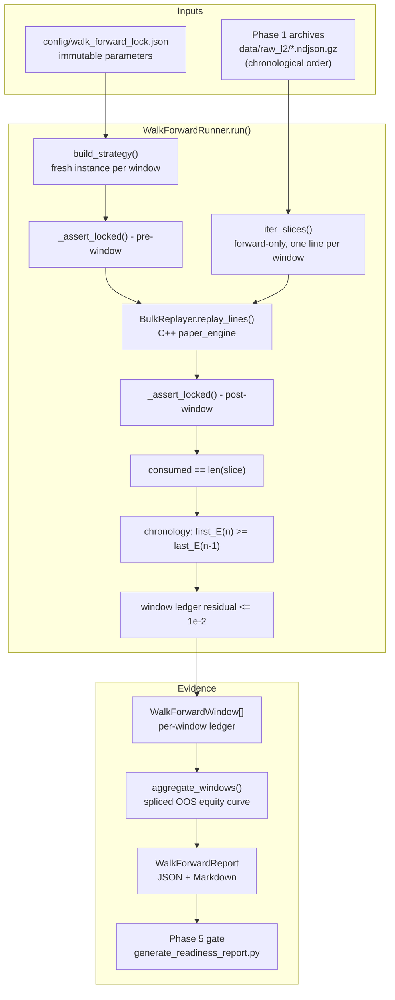

# ZephyrHFT — Phase 4: Walk-Forward Out-of-Sample Validation

**Frozen-parameter historical replay, parameter locking and look-ahead prevention**

| Field | Value |
| --- | --- |
| Document ID | `ZHFT-DOC-P4` |
| Version | 1.0.0 |
| Status | Implemented / Verified |
| Depends on | Phase 1 (NDJSON capture), Phase 2 (`paper_engine`), Phase 3 (`BulkReplayer`, metrics, optimiser) |
| Related | [`phase3_backtesting_architecture.md`](./phase3_backtesting_architecture.md), [`phase5_production_readiness.md`](./phase5_production_readiness.md) |
| Code | `python_analytics/backtesting/walk_forward.py`, `scripts/run_walk_forward.py` |
| Artefacts | `reports/walk_forward.{json,md}`, `config/walk_forward_lock.json` |

---

## 1. Objective

Phase 3 answers *"what did this parameter set earn on this archive?"* Phase 4
answers the question that actually gates a deployment:

> **Does a frozen parameter set keep earning on data it was never fitted to?**

A single backtest over the data you tuned on is an in-sample number, and an
in-sample Sharpe is a statement about the optimiser, not about the market. Phase
4 removes every degree of freedom a run could use to flatter itself: the
parameters are frozen and fingerprinted **before** the first window, re-read from
the live strategy **around** every window, and the windows are consumed from a
single forward-only stream so no window can observe another window's data.

### 1.1 What this phase does and does not prove

| Proven | Not proven |
| --- | --- |
| The reported PnL/Sharpe/drawdown were produced by one unchanging parameter set | That the parameter set is optimal, or profitable on live data |
| No window saw events outside its own slice, and exchange time never moved backwards | That the archive is free of survivorship or venue-side bias |
| Equity chains across windows within the configured ledger tolerance (`--ledger-tolerance`, default `1e-2` per window; the aggregate ceiling is `1e-2 × windows`) | That fills are realisable — the C++ `paper_engine` is a taker-cross simulator |
| The study is bit-reproducible from a committed lock file | That regime change between windows was modelled |

Profitability is **not** an implicit Phase 4 gate. The gate a build passes is
*machinery* correctness; whether the alpha earns is an explicit, separate,
opt-in decision (`--min-sharpe`, or `--min-oos-sharpe` in Phase 5). Conflating the
two hides which one is broken.

### 1.2 Threat model

| Failure a naive walk-forward hides | Where Phase 4 stops it |
| --- | --- |
| Re-tuning between windows ("walk-forward" only in name) | `LockedParameters` is immutable, and the module never imports the optimiser (§4.3) |
| A window silently overlapping its neighbours | Forward-only slicing; each line is yielded exactly once (§3.1) |
| A strategy mutating its own config mid-run | Pre- **and** post-window read-back of nine live fields (§4.3) |
| Results computed against a locked file that was hand-edited | Fingerprint re-derived from the file's own parameters (§4.2) |
| Inventory at a window boundary vanishing (or double-counting) | Boundary mark-to-market settlement (§3.3) |
| A ledger that quietly stops balancing | Residual asserted per window and in aggregate (§3.2) |

---

## 2. Architecture

### 2.1 Execution pipeline



Every gate above (`B3`, `B5`–`B8`) raises *before* a window's ledger can enter
`C2`. A walk-forward that cannot prove its invariants is not a result, so the
module fails the run instead of degrading the report.

### 2.2 Design decisions

| Decision | Rationale |
| --- | --- |
| **Independent windows, one shared lock** | Each window gets its own `AvellanedaStoikovStrategy` and its own replayer; a shared instance would leak state, and a stateless one would hide the leak |
| **`WalkForwardRunner` never imports `optimizer`** | A re-tune is impossible to express, not merely discouraged |
| **Equity is chained, not reset** | Window *n+1* starts with window *n*'s closing equity, so the aggregate is one continuous account, not a sum of detached experiments |
| **Boundary inventory is settled, not carried** | Each window opens flat, so exposure left at a boundary becomes realised PnL (`boundary_settled_pnl`); only the final window keeps unrealised PnL |
| **Returns-based Sharpe, not levels** | Equity levels are ~1e5 with ~1e-3 variance; computing the ratio on levels inflates it by ~1e4 |
| **Missing timestamps fail closed at the gate, not in the runner** | Without an `E` field the run completes with `chronology_verified = false`; the report says `not verifiable (no timestamps)` and Phase 5's `phase4.no_look_ahead` rejects the study |

---

## 3. Execution model

### 3.1 Windowing

`--window-events N` re-slices each archive into contiguous fixed-size event
blocks; `--window-events 0` (default) treats **one archive as one window**, the
natural unit when Phase 1 writes hourly roll files.

| Property | Behaviour |
| --- | --- |
| Order | Determined by CLI argument order; globs expand in sorted order, so `data/raw_l2/*.ndjson.gz` is chronological by construction |
| Isolation | `iter_slices()` yields each line exactly once — a frame handed to window *n* is never handed to window *n+1* |
| Memory | Streaming: only one window's lines are resident, so multi-gigabyte archives replay in flat memory |
| Labels | `"{filename}#{offset}"`, e.g. `sample_events.ndjson#400` is the second 400-event slice of that file |
| Duplicates | Repeated paths are de-duplicated by `resolve_sources`, so passing the same archive twice cannot manufacture an artificial "second window" |

A trailing partial window is kept (900 events at `--window-events 400` gives
400 + 400 + 100). Windows are deliberately **not** re-balanced to equal size:
dropping the tail would silently discard the most recent — and usually most
relevant — data.

### 3.2 Per-window protocol

| # | Step | Enforcement |
| --- | --- | --- |
| 1 | Build a fresh strategy from the locked parameters | `LockedParameters.build_strategy()` |
| 2 | Read the live strategy back and compare it with the expected lock | `ParameterLockError` on any drift |
| 3 | Replay the window's slice through the C++ `paper_engine` | `BulkReplayer` (taker cross, fees, slippage) |
| 4 | Read the live strategy back **again** after the window | `ParameterLockError` on any drift |
| 5 | Assert the replayer consumed exactly the slice it was given | `LookAheadError` if `stats["lines"] != len(lines)` |
| 6 | Assert exchange time did not move backwards across the boundary | `LookAheadError` if `first_E < previous_last_E` |
| 7 | Assert `Δequity == realized + unrealized` for the window | `WalkForwardError` above `--ledger-tolerance` (1e-2) |
| 8 | Chain `equity ← end_equity` and record the window | `WalkForwardWindow` |

The aggregate is then re-asserted with the tolerance scaled by the window count
(`1e-2 × windows`), so a two-window study must balance to `2e-2`, while a
hundred-window study is not granted a licence to drift.

### 3.3 Boundary mark-to-market settlement

Each window opens flat, so a position still open at a boundary is booked as a
**realised** settlement at that window's final mark. The identity the aggregate
must satisfy is:

```text
net_pnl = realized_pnl + unrealized_pnl
```

`realized_pnl` here is the **reported** aggregate figure: it already includes the
boundary settlements. Expanded, the same identity is
`net_pnl = in_window_realized_pnl + boundary_settled_pnl + unrealized_pnl`.

| Term | Definition |
| --- | --- |
| `in_window_realized_pnl` | PnL closed by fills inside the windows |
| `boundary_settled_pnl` | Sum of `unrealized_pnl` of every **non-final** window, settled at its last mid |
| `realized_pnl` (reported) | `in_window_realized_pnl + boundary_settled_pnl` — the term used in the identity above |
| `unrealized_pnl` (reported) | The final window's open PnL only — carried exactly once |
| `ledger_residual` | `net_pnl − (realized_pnl + unrealized_pnl)`, expected `~1e-7` |

Without this convention, boundary inventory is either dropped (PnL understated)
or counted twice (equity inflated). Committed baseline: residual `+1.4e-7`.

### 3.4 Aggregation

`aggregate_windows()` splices the per-window equity curves, dropping the first
sample of each later window because it only repeats the previous close — keeping
it would inject a zero return and bias Sharpe downward.

| Metric | Definition |
| --- | --- |
| `sharpe_ratio` / `sortino_ratio` | Per-sample returns of the spliced curve, annualised by `--periods-per-year` (default 252) |
| `max_drawdown_pct` | Peak-to-trough on the spliced curve |
| `win_rate_pct`, `profit_factor`, `win_loss_ratio` | From round trips reconstructed across windows |
| `window_hit_rate_pct` | Fraction of windows with positive net PnL |
| `fill_ratio_pct` | Filled / submitted quantity |
| `throughput_fps` | Depth events per wall-clock second of the whole study |

`--periods-per-year` is a **reporting convention, not a calendar claim**: the
curve is sampled once per replayed frame, so on a 250 ms grid "annualised" means
"scaled by √252", not "projected over a year". Compare Sharpe across runs that
use the same factor, never against a live track record.

---

## 4. Parameter locking

### 4.1 The lock file

`config/walk_forward_lock.json` is committed alongside the code, so the fit that
produced the reported OOS numbers is auditable by anyone who checks out the
repository.

```json
{
  "phase": 4,
  "kind": "walk_forward_parameter_lock",
  "written_at": "2026-10-24T17:00:02+00:00",
  "fingerprint": "b29a62ed93caf69a",
  "parameters": {
    "strategy": {
      "gamma": 0.1, "sigma": 0.02, "k": 5.0, "time_horizon": 60.0,
      "inventory_limit": 5.0, "ofi_sensitivity": 0.0,
      "ofi_decay": 0.95, "ofi_cap": 3.0, "use_time_spread": true
    },
    "venue":  { "tick_size": "0.50", "center": "30000", "market_type": "CRYPTO" },
    "costs":  { "maker_bps": 2.0, "taker_bps": 5.0 },
    "sizing": { "initial_cash": 100000.0, "order_quantity": "0.01" }
  },
  "metadata": { "source": ["data/sample_events.ndjson"], "window_events": 400 }
}
```

Every knob that can change a quote lives in the lock — risk aversion, volatility,
liquidity, horizon, inventory cap, OFI coupling, venue grid, fees and size. There
is deliberately no second configuration path: `WalkForwardRunner` reads only the
`LockedParameters` instance it was constructed with.

| Section | Fields | Why it is locked |
| --- | --- | --- |
| `strategy` | 9 fields | Directly shape the reservation price and spread; re-read from the live object |
| `venue` | `tick_size`, `center`, `market_type` | Change the price grid and adapter semantics, and therefore the fills |
| `costs` | `maker_bps`, `taker_bps` | Retail USDⓈ-M rates (2 / 5 bps); a negative maker is a rebate tier, and unmodelled costs are how losing studies look profitable |
| `sizing` | `initial_cash`, `order_quantity` | Set risk per quote and the equity scale every ratio is measured on |

`from_dict()` rejects unknown fields and missing fields inside each section, so a
typo cannot silently fall back to a dataclass default. (An entirely unknown
*section* is ignored — it changes nothing that shapes a quote, and rejecting it
would break forward compatibility of the schema.)

### 4.2 Fingerprint

```python
payload = json.dumps(self.as_dict(), sort_keys=True, separators=(",", ":"))
fingerprint = hashlib.sha256(payload.encode("utf-8")).hexdigest()[:16]
```

A SHA-256 over canonical JSON, truncated to 16 hex characters. It is *derived
from* the parameter values and never stored as an independent assertion, so
`read_lock_file()` recomputes it and refuses a file that disagrees with itself:

```text
error: lock file config/walk_forward_lock.json fingerprint a3aa7022dbbbab72
does not match its parameters (300e40639f4d8b17); the file was edited by hand
```

That single check is what makes "the study was run under lock X" a claim a third
party can verify from the repository, rather than a claim about the operator's
memory.

### 4.3 Three enforcement layers

| Layer | Mechanism | Catches |
| --- | --- | --- |
| Construction | `LockedParameters` is an immutable dataclass; unknown keys and unknown `MarketType` are rejected in `from_dict` / `__post_init__` | Typo'd or smuggled parameters, bad venue names |
| Runtime | `parameter_lock_of(strategy)` reads nine live fields off the strategy **before and after** each window and compares them with `strategy_lock()` | Self-mutating strategy, wrong `MarketConfig`, state leaking across windows |
| File | `read_lock_file()` re-derives the fingerprint from the file's own parameters | Hand-edited locks, merge conflicts resolved by taking "both sides" |

A two-window study therefore performs four checks (`2 × windows`), which is
exactly what Phase 5 reports as `phase4.parameter_lock`.

Because `walk_forward.py` imports `AvellanedaStoikovStrategy` and `BulkReplayer`
but never `optimizer`, re-fitting between windows is not a behaviour that is
merely forbidden — it is unreachable from this module.

### 4.4 Lifecycle

```text
fit (optimiser, Phase 3)
  └─ run_walk_forward.py --write-lock config/walk_forward_lock.json   # persist the fit
       └─ git commit                                                   # lock + report together
            ├─ CI / auditor: --from-lock --lock-file …                 # replay verbatim
            └─ manual check: --lock-file … (parameters restated)        # refuses on drift
```

| Flag | Behaviour |
| --- | --- |
| `--write-lock PATH` | Persists the effective lock (after any `--lock-file` reconciliation) with `source` and `window_events` metadata |
| `--lock-file PATH` | Loads the lock and **requires** every CLI parameter to match it; a mismatch is a usage error before any replay |
| `--from-lock` | The lock is the single source of truth; stray CLI flags are ignored rather than silently reconciled. Requires `--lock-file` |

`--from-lock` exists because an audit run must not depend on remembering sixteen
flags. It is the path `readiness.yml` uses to replay the committed lock, so the
nightly gate cannot drift from the fit that was reviewed.

> **Precedence:** `--from-lock` > `--lock-file` > CLI flags. Without
> `--from-lock`, the CLI is the proposal and the lock is the veto.

### 4.5 Scope and non-guarantees

The lock freezes **strategy and venue configuration**, not the world:

- Book state, seed/snapshot and event stream are *inputs*; they are what the
  windows vary, and they are not locked.
- Replay mechanics (`--batch-size`, `--frames-per-hook`, `--ledger-tolerance`,
  `--periods-per-year`) are recorded in the report but not hashed into the
  fingerprint — they change *how* the same parameters are measured, not what they
  are. Keep them constant when comparing runs.
- The lock proves the **validation** run did not re-fit. It cannot prove the
  parameters were fitted without leakage upstream; that must be excluded where
  the Phase 3 study is designed.

---

## 5. Look-ahead prevention

### 5.1 The mechanical checks

| Check | Implementation | Violation |
| --- | --- | --- |
| Slice isolation | `iter_slices()` is forward-only; a line is yielded once | Structural — not expressible through the API |
| Slice accounting | `summary.stats["lines"] == len(lines)` after every window | `LookAheadError`: *"ingested N lines but was handed M"* |
| Chronology | `first_E(n) >= last_E(n-1)`, counted per boundary | `LookAheadError`: *"starts at … ms, before the previous window closed at … ms"* |
| Lock read-back | Pre/post-window comparison of live parameters | `ParameterLockError` (§4.3) |

The chronology proof uses a targeted regex on the exchange `E` field rather than
a full JSON decode per line: the C++ parser already validates the payload, and
this counter only needs the timestamp.

### 5.2 What a violation looks like

Two archives passed in the wrong order:

```bash
python3 scripts/run_walk_forward.py --source /tmp/b.ndjson /tmp/a.ndjson --no-report
# validation failure: window a.ndjson#0 starts at 1700000000000 ms, before the
# previous window closed at 1700000019900 ms; reorder the archives so time only
# moves forward
# exit code 3
```

The run aborts and no report is written. That is the intended failure mode: a
chronology violation is a statement about the *experiment*, and averaging it into
a result would launder the defect into a number.

### 5.3 Limits of the guarantee

- **Equal timestamps are allowed** (`>=`, not `>`). Depth streams legitimately
  carry several frames per millisecond; a strict inequality would reject valid
  archives.
- **Archives without `E` make chronology unprovable.** The run still completes,
  and both the console and the Markdown report say
  `not verifiable (no timestamps)`. Phase 5's `phase4.no_look_ahead` requires
  `chronology_checks > 0`, so a timestamp-free archive fails the readiness gate
  instead of passing quietly.
- **A single-window study has no boundary**, so `chronology_checks == 0`. Phase 5
  therefore also requires at least two windows (`--min-windows`, default 2).
- The guard proves *ordering*, not *causality*: it cannot detect leakage inside a
  source archive that was assembled from future data.

---

## 6. Reproduction

### 6.1 Prerequisites

```bash
cd /path/to/ZephyrHFT
python3 -m pip install -r requirements.txt
cmake -S cpp_engine -B build -DHFT_BUILD_PYTHON=ON
cmake --build build --parallel
```

Run the commands below from the repository root; the scripts bootstrap
`sys.path` themselves.

### 6.2 Fit and persist a lock (bundled sample)

```bash
python3 scripts/run_walk_forward.py \
  --source data/sample_events.ndjson \
  --window-events 400 \
  --k 5.0 \
  --write-lock config/walk_forward_lock.json \
  --report-dir reports
```

This is the command that produced the committed fit: two 400-event windows,
fingerprint `b29a62ed93caf69a`, artefacts `reports/walk_forward.{json,md}`.
The command omits `--maker-bps`/`--taker-bps`, so it runs at the retail USDⓈ-M
VIP 0 defaults (`2`/`5` bps) defined in `python_analytics.costs` — not at a
rebate tier.

> It **overwrites** those two artefacts (the `generated_at` stamp changes even
> when every number reproduces), so re-run it deliberately and review
> `git diff reports/` before committing.

### 6.3 Verify a committed lock, verbatim

```bash
python3 scripts/run_walk_forward.py \
  --source data/sample_events.ndjson \
  --window-events 400 \
  --from-lock --lock-file config/walk_forward_lock.json
```

No parameter flags — this is the audit path, and the path CI takes. If the lock
was edited by hand, the run stops before replaying anything (exit 2).

### 6.4 Verify while restating the parameters

```bash
python3 scripts/run_walk_forward.py \
  --source data/sample_events.ndjson \
  --window-events 400 \
  --k 5.0 \
  --lock-file config/walk_forward_lock.json
```

Any disagreement is fatal:

```text
error: --lock-file config/walk_forward_lock.json mismatch (1 field(s)):
strategy.k: 2.0 != 5.0
```

### 6.5 Out-of-sample study over captured data

```bash
python3 scripts/run_walk_forward.py \
  --source 'data/raw_l2/*.ndjson.gz' \
  --window-events 5000 \
  --from-lock --lock-file config/walk_forward_lock.json \
  --min-sharpe 0.5 \
  --report-dir reports --stem walk_forward_live_capture
```

Globs expand in sorted order, which is chronological because Phase 1 roll file
names embed a UTC start stamp and a sequence number.

> **A study needs at least two windows to be evidence.** With
> `--window-events 5000` that means more than 5,000 captured frames, so
> `data/raw_l2` has to be created first: a live capture long enough to exceed
> 5,000 frames (`python3 scripts/ingest_l2.py --duration 600` on the 100 ms
> stream), or `python3 scripts/ingest_l2.py --replay data/sample_events.ndjson
> --output-dir data/raw_l2` to exercise the path offline. It is capture output,
> not a tracked fixture. A short capture produces one window, zero chronology
> checks and zero trades (Sharpe `0.000`) — enough to prove the pipeline runs,
> not enough to say anything about a strategy. Phase 5 rejects such a study as
> `phase4.window_coverage` / `phase4.no_look_ahead`, and `--min-sharpe` exits `1`
> on it.

### 6.6 Gates and exit codes

| Flag | Effect |
| --- | --- |
| `--min-sharpe X` | Exit `1` when OOS Sharpe `< X` |
| `--min-pnl X` | Exit `1` when net OOS PnL `< X` |

| Exit | Meaning |
| --- | --- |
| `0` | Study completed, invariants held, optional gates passed |
| `1` | A `--min-sharpe` / `--min-pnl` gate failed (the study itself is valid) |
| `2` | Usage error: bad flag, `--from-lock` without `--lock-file`, lock mismatch, tampered lock, missing archive |
| `3` | Validation violation: `LookAheadError` / `WalkForwardError` (ledger residual) |

`1` and `3` are deliberately distinct: *"the alpha is too weak"* must never be
mistaken for *"the measurement is broken"*.

### 6.7 CLI reference

| Flag | Default | Notes |
| --- | --- | --- |
| `--source` | `data/sample_events.ndjson` | One or more paths/globs, chronological order |
| `--window-events` | `0` | `0` = one window per archive |
| `--gamma` | `0.1` | Risk aversion |
| `--sigma` | `0.02` | Volatility |
| `--k` | `1.5` | Liquidity / order-arrival intensity |
| `--time-horizon` | `60.0` | Seconds |
| `--inventory-limit` | `5.0` | Absolute position cap |
| `--ofi-sensitivity` | `0.0` | OFI skew weight (`0` disables OFI) |
| `--ofi-decay` | `0.95` | OFI EMA decay |
| `--ofi-cap` | `3.0` | OFI z-score clamp |
| `--no-time-spread` | off | Disables the `γσ²(T−t)` spread term |
| `--market-type` | `CRYPTO` | `CRYPTO` / `STOCK` / `COMMODITIES` |
| `--tick-size`, `--center` | from `config/settings.yaml` | Venue grid |
| `--maker-bps`, `--taker-bps` | `2.0`, `5.0` | Fractional bps; retail VIP 0 (negative maker = rebate tier) |
| `--initial-cash`, `--order-quantity` | `100000.0`, `0.01` | Sizing |
| `--batch-size`, `--frames-per-hook` | `64`, `1` | Replay batching; `1` = strategy per frame |
| `--periods-per-year` | `252.0` | Sharpe/Sortino annualisation |
| `--ledger-tolerance` | `1e-2` | Max per-window ledger residual |
| `--lock-file`, `--from-lock`, `--write-lock` | — | See §4.4 |
| `--report-dir`, `--stem`, `--no-report` | `reports`, `walk_forward`, off | Artefacts |
| `--min-sharpe`, `--min-pnl` | — | Opt-in gates (§6.6) |
| `--log-level` | `INFO` | `WARNING` for CI noise |

---

## 7. Artefacts

### 7.1 Files

| Path | Content |
| --- | --- |
| `reports/walk_forward.json` | Machine-readable evidence, consumed by Phase 5 (`--walk-forward-json`) |
| `reports/walk_forward.md` | Human-readable report: frozen parameters, aggregate OOS table, window ledger |
| `config/walk_forward_lock.json` | The committed fit (§4.1) |

`reports/walk_forward.json` is committed because it is the input to the readiness
gate: the gate then verifies the study that was reviewed, not a study it invented
on the spot.

### 7.2 JSON schema

| Key | Content |
| --- | --- |
| `report` | `"phase4_walk_forward"` |
| `generated_at` | ISO-8601 UTC |
| `elapsed_s` | Wall-clock duration of the study |
| `validation.parameter_lock` | `verified`, `fingerprint`, `source`, `checks`, full `parameters` |
| `validation.look_ahead` | `verified`, `chronology_verified`, `chronology_checks`, `windows_checked` |
| `validation.ledger` | `residual`, `tolerance` (already scaled by window count) |
| `inputs` | `sources`, `window_events`, `windows` |
| `aggregate` | Every metric defined in §3.4 |
| `windows[]` | Per-window ledger: label, offset, events, equity path, fills, round trips, stats subset |
| `equity_curve` | Downsampled to ≤ 2000 points to bound artefact size |

Non-finite floats (e.g. `profit_factor` with no losing trades) serialise as
`null`, never as `Infinity`.

### 7.3 Committed baseline

Produced by §6.2 on `data/sample_events.ndjson` (800 depth events, centre 30000,
tick 0.50):

| Metric | Value |
| --- | --- |
| Windows / events | 2 / 800 |
| Parameter lock | `b29a62ed93caf69a`, 4 checks (2 pre + 2 post) |
| Chronology checks | 1 (one boundary) |
| Net PnL | `-15.7830` (`-0.0158%`) |
| Realized / boundary / unrealized | `-15.4417` (of which `-0.3929` boundary) / `-0.3413` |
| Fees paid | `+13.7330` on `68,664.88` notional (2 bps maker, 5 bps taker) |
| Fills / round trips | 229 / 105 |
| Win rate / profit factor | `32.38%` / `0.504` |
| Sharpe / Sortino | `-3.987` / `-4.344` |
| Max drawdown | `0.0160%` |
| Fill ratio | `16.47%` |
| Window hit rate | `0%` (0 positive, 2 negative) |
| Ledger residual | `-1.1e-7` (tolerance `2.0e-2`) |

> **These numbers were re-measured after the depth-parser fix.** The ladder now
> keeps the levels nearest the touch, so the marked book and the mark-to-market
> leg differ from the figure this table carried before (`-16.4743` on the same
> 229 fills and the same notional); the conclusion did not change.

> **This is a red result, and it is reported as one.** The same 800 events at the
> rebate tier this repository used to default to (`maker_bps = -1.0`, a different
> lock because the fees are part of the fingerprint) report `+4.8165` net; at
> retail fees they report `-15.7830`. Nothing in the strategy changed — only the
> cost assumption did, which is exactly why the assumption is now a tested gate
> rather than a default. At *zero* fees the study still loses `2.05`, so the
> quoting logic does not earn on this book either; the param set needs signal work
> before it can be promoted.

> **Read this as machinery evidence, not alpha.** The bundled sample is a
> synthetic walk: the point of the table is that the pipeline reports what it
> measured — including a loss — not that the strategy works. Judging an alpha
> requires a real capture and `--min-sharpe`.

---

## 8. Troubleshooting

| Symptom | Cause | Action |
| --- | --- | --- |
| `error: --lock-file … mismatch (1 field(s)): strategy.k: 2.0 != 5.0` (exit 2) | CLI disagrees with the lock | Restate the locked value, or use `--from-lock` and drop the flag |
| `error: --from-lock requires --lock-file` (exit 2) | `--from-lock` used alone | Add `--lock-file config/walk_forward_lock.json` |
| `error: lock file … fingerprint … does not match its parameters` (exit 2) | Lock edited by hand or a bad merge | Regenerate with `--write-lock` from the intended fit, then review the diff |
| `error: lock is missing strategy.k` / `unknown lock field(s)` (exit 2) | Hand-written or partially merged lock | Regenerate the lock; never hand-edit it |
| `validation failure: window … starts at … before the previous window closed` (exit 3) | Archives out of order, or two captures overlapping in time | Sort by the UTC stamp in the filename; never mix symbols in one study |
| `validation failure: … ingested N lines but was handed M` (exit 3) | Replayer stopped early (malformed frames, `event_limit`) | Check `gap_events` / `malformed_events` in the window ledger and the archive itself |
| `window … ledger residual … exceeds tolerance` (exit 3) | Accounting defect, or a fill booked without a mark | Reproduce on one window (`--window-events 0`) and compare `realized` with `end_equity − start_equity` |
| `look-ahead guard: … not verifiable (no timestamps)` | Archive has no `E` field | Re-capture with `ingest_l2.py`; Phase 5 will fail `phase4.no_look_ahead` |
| `no events were replayed; nothing to validate` (exit 3) | Empty archive or a glob that matched nothing useful | `wc -l` the inputs; keep globs quoted so the shell does not expand them first |
| Sharpe far above the in-sample value | Too few or too short windows | Extend coverage; treat fewer than three windows as anecdote |
| PnL positive but `profit_factor < 1` | Many small wins, fewer larger losses | Inspect the per-window ledger; one window can dominate the aggregate |

---

## 9. Verification status

| Area | Coverage |
| --- | --- |
| Replay flow, conflicting flags, missing lock, `--from-lock` precedence | `tests/python/test_phase4_walk_forward.py` |
| Lock round-trip, fingerprint derivation, tamper detection | `LockedParameters` / `read_lock_file` unit tests |
| Look-ahead detection | Slice-accounting and chronology tests |
| Consumption by the readiness gate | `tests/python/test_production_readiness.py` (Phase 4 checks) |
| CI | `.circleci/config.yml` scans the commits under review for secrets with `ggshield` and runs the suite on py3.9 and py3.12; `readiness.yml` replays the committed lock with `--from-lock` nightly and on every `v*` tag |

Observed on the committed baseline: `pytest` 232 passed; the study reproduces to
the last digit on the bundled sample; exit codes match §6.6 (`0` success, `2` lock
/ usage errors, `3` chronology violation).
